# Dossier de conception fonctionnelle et technique — Plateforme de santé orientée patient

**Type de livrable :** Business Requirements Document (BRD) + Functional Specifications (FSD) + Solution Architecture Document (SAD) + modèle de données  
**Version :** 1.0  
**Date :** 5 octobre 2026  
**Statut :** Architecture cible proposée — à valider par les autorités cliniques, juridiques, sécurité et protection des renseignements personnels  
**Public cible :** direction produit, directions clinique et médicale, architecture d’entreprise, sécurité, protection des renseignements personnels, équipes de développement, exploitation, partenaires d’interopérabilité et organismes payeurs

---

## Résumé exécutif

La solution proposée est une plateforme multicanale — Web, applications mobiles iOS/Android et API — destinée à agréger, structurer, échanger et présenter les renseignements de santé d’une personne. Elle place le patient au centre des décisions de partage, sans prétendre supprimer les responsabilités légales, professionnelles ou de conservation qui incombent aux organismes et professionnels détenteurs des dossiers sources.

La plateforme repose sur six principes structurants :

1. **Consentement explicite et calculable** : chaque accès est évalué selon l’identité, le rôle, la relation de soins, la finalité, le périmètre clinique, la durée, le contexte, la juridiction et les obligations légales.
2. **Aucune donnée médicale dans le QR Code** : le code contient un jeton opaque, signé, à durée de vie courte, à usage unique et lié à un contexte. Il ne contient ni identifiant permanent du patient ni renseignement clinique.
3. **Interopérabilité native** : modèle canonique aligné sur HL7 FHIR, ingestion HL7 v2/CDA, imagerie DICOM/DICOMweb, terminologies SNOMED CT, LOINC, ICD-10/ICD-11 et UCUM.
4. **Zero Trust et confidentialité dès la conception** : authentification forte, autorisation RBAC + ABAC + consentement, moindre privilège, chiffrement, segmentation, journal d’audit inviolable et contrôle continu.
5. **Traçabilité clinique complète** : provenance, auteur, source, versions, corrections, signatures, consultations et divulgations sont historisés; les données cliniques signées ne sont jamais modifiées silencieusement.
6. **Évolution maîtrisée** : démarrage recommandé en monolithe modulaire, avec événements de domaine et contrats stables, puis extraction progressive de services quand le volume, l’autonomie organisationnelle ou les exigences de disponibilité le justifient.

La cible couvre les soins, la prévention, les prescriptions, le laboratoire, l’imagerie, la vaccination, la télésanté, la messagerie sécurisée, les documents, les assurances, la facturation, les objets connectés, la délégation à un proche, les urgences et l’audit. Le modèle logique documente 220 tables regroupées par domaines et prévoit le partitionnement, la pseudonymisation, l’historisation et la séparation des données fortement sensibles.

> **Décision juridique à ne pas éluder.** « Le patient est propriétaire de ses données » est retenu comme principe produit de maîtrise, de transparence et de portabilité. Selon la juridiction, il ne s’agit pas nécessairement d’un droit de propriété absolu sur chaque dossier clinique. Au Québec, les droits du patient coexistent notamment avec la Loi sur les renseignements de santé et de services sociaux, les règles propres aux organismes détenteurs, les obligations des ordres professionnels et les durées légales de conservation. Le moteur de politique doit donc pouvoir appliquer une règle légale prioritaire, explicable et auditée, sans transformer une préférence produit en conclusion juridique.

---


# 1. Vision produit

## 1.1 Vision

Créer un espace de santé numérique de confiance dans lequel chaque patient peut :

- consulter une vue longitudinale, compréhensible et vérifiable de sa santé;
- décider qui peut accéder à quelles catégories de données, pour quelle finalité et pendant combien de temps;
- recevoir et partager des documents cliniques sans rupture de parcours;
- participer activement à la prévention, au suivi des traitements et à la coordination des soins;
- connaître, après coup, qui a consulté ou modifié quoi, quand, pourquoi et dans quel contexte.

Pour les professionnels, la plateforme doit offrir une vue clinique synthétique, fiable et contextualisée, diminuer la ressaisie, accélérer la coordination et rendre les décisions d’accès explicites sans nuire aux soins urgents.

## 1.2 Objectifs stratégiques

| Objectif | Résultat attendu | Indicateur cible à 24 mois |
|---|---|---|
| Unifier le dossier longitudinal | Données de sources multiples rapprochées et présentées avec leur provenance | ≥ 90 % des documents entrants associés automatiquement ou assistés au bon patient |
| Donner une maîtrise réelle au patient | Consentements granulaires, révocables et compréhensibles | ≥ 95 % des décisions d’accès expliquées en langage clair |
| Réduire les ruptures informationnelles | Échange FHIR/HL7/DICOM et notifications événementielles | ≥ 80 % des résultats structurés intégrés sans ressaisie |
| Améliorer la sécurité clinique | Alertes utiles, allergies, interactions, résultats critiques | 100 % des résultats critiques suivis par un accusé de prise en charge |
| Assurer la conformité démontrable | Journal d’audit, preuves de consentement, conservation | 100 % des accès à des données sensibles traçables |
| Soutenir l’échelle nationale/SaaS | Multi-organisation, haute disponibilité, observabilité | SLO lecture clinique ≥ 99,95 %; RPO ≤ 5 min; RTO ≤ 60 min |
| Améliorer l’expérience | Accès mobile, langage simple, accessibilité | SUS ≥ 80; WCAG 2.2 AA |

## 1.3 Enjeux

### Enjeux métier

- fragmentation des dossiers entre cliniques, hôpitaux, laboratoires, pharmacies et appareils personnels;
- identité patient imparfaite et risques de collision ou de doublon;
- consentements trop généraux, non exécutables ou difficiles à révoquer;
- tension entre autonomie du patient, continuité des soins, obligations légales et situations d’urgence;
- nécessité de préserver la responsabilité clinique : le portail patient ne remplace ni le dossier source ni le jugement professionnel;
- qualité variable des données et absence fréquente de codification normalisée.

### Enjeux techniques

- intégration de flux synchrones, asynchrones, fichiers, HL7 v2, FHIR, DICOM et API partenaires;
- haute volumétrie documentaire et imagerie;
- décisions d’autorisation à faible latence et explicables;
- séparation multi-locataire sans fuite transversale;
- traçabilité inviolable et exploitation de plusieurs millions d’utilisateurs;
- résilience face aux pannes de partenaires et fonctionnement dégradé en contexte clinique.

### Enjeux réglementaires

- localisation et transfert transfrontalier des données;
- consentement manifeste, libre, éclairé, spécifique et limité à la durée nécessaire;
- minimisation, finalité, accès, rectification, portabilité lorsque applicable, conservation et destruction/anonymisation;
- notification et traitement des incidents;
- conservation probante des dossiers, signatures et journaux;
- exigences différentes selon le rôle de la plateforme : fournisseur SaaS, mandataire, sous-traitant, organisme de santé, professionnel ou dépositaire.

## 1.4 Périmètre

### Inclus

- identité patient, identité professionnelle et organisations;
- dossier longitudinal et ligne du temps clinique;
- consentement et autorisation granulaire;
- QR/code-barres de mise en relation et demande d’accès;
- rendez-vous, télésanté, prescriptions, laboratoire, imagerie, vaccination;
- documents, signatures, messagerie, notifications;
- assurances, réclamations et facturation de base;
- données déclarées par le patient et mesures connectées;
- interopérabilité, terminologies, provenance, audit et analytique opérationnelle.

### Hors périmètre initial

- diagnostic autonome ou recommandation thérapeutique sans supervision;
- remplacement du PACS, LIS, RIS, pharmacie ou DME source;
- modification destructrice d’un dossier clinique signé;
- entrepôt de recherche secondaire sans gouvernance dédiée;
- calcul national complet des remboursements de toutes les juridictions;
- stockage de séquences génomiques brutes dans la base transactionnelle principale.

## 1.5 Principes produit

| Principe | Conséquence de conception |
|---|---|
| Patient au centre | Centre de préférences, consentements lisibles, journal de transparence, export |
| Source explicite | Toute donnée affiche son auteur, son organisme, sa date, sa source et son statut de vérification |
| Sécurité sans ambiguïté | Refus par défaut; aucun accès implicite fondé uniquement sur la possession du QR |
| Urgence encadrée | « Bris de glace » limité, motivé, renforcé par MFA, alerté et révisé a posteriori |
| Données minimales | Le professionnel reçoit seulement les champs nécessaires à la finalité autorisée |
| Non-répudiation | Signature, empreinte, horodatage fiable, version et preuve de consentement |
| Accessibilité | Français/anglais, WCAG 2.2 AA, langage clair, compatibilité lecteurs d’écran |
| Portabilité | Export FHIR, PDF lisible et archive structurée selon les droits applicables |
| Évolutivité | Domaines découplés, événements versionnés, compatibilité ascendante |

## 1.6 Personas

| Persona | Besoins | Risques à maîtriser |
|---|---|---|
| Patient autonome | Vue complète, consentements, résultats, rappels | Surcharge d’information, mauvaise interprétation |
| Patient atteint de maladie chronique | Mesures, traitements, équipe de soins, alertes | Données IoT erronées, fatigue d’alertes |
| Patient vulnérable ou peu numérique | Délégation, accessibilité, soutien | Abus du mandataire, exclusion numérique |
| Parent/tuteur/mandataire | Accès adapté au rôle légal et à l’âge | Conflit avec droits du mineur, mandat expiré |
| Médecin généraliste | Synthèse, médicaments, allergies, résultats, coordination | Données non validées ou incomplètes |
| Médecin spécialiste | Contexte ciblé, imagerie, laboratoire | Accès trop large sans finalité |
| Infirmier/sage-femme | Plan de soins, observations, tâches | Actions au-delà du champ d’exercice |
| Pharmacien | Ordonnances, allergies, interactions, dispensation | Prescription révoquée ou doublon |
| Laboratoire/radiologie | Ordres, identité, résultats, validation | Mauvais rapprochement patient |
| Psychologue | Notes hautement sensibles, partage restreint | Divulgation de notes protégées |
| Ambulancier/urgentiste | Informations vitales immédiates | Usage abusif du bris de glace |
| Administrateur d’organisation | Comptes, rôles, conformité | Accès métier injustifié aux données cliniques |
| Responsable vie privée/sécurité | Enquêtes, rapports, politiques | Journal altérable, manque de contexte |

## 1.7 Parcours utilisateurs majeurs

### Parcours A — Inscription et consolidation du dossier

1. Le patient crée un compte et vérifie son identité à niveau d’assurance élevé.
2. Il accepte séparément les conditions d’utilisation et les consentements facultatifs.
3. Il ajoute ses identifiants de santé et organismes de soins; le MPI produit des correspondances candidates.
4. Les correspondances à risque sont placées en revue humaine; aucune fusion irréversible n’est automatique.
5. Les sources autorisées importent les données; la provenance et le niveau de confiance sont affichés.
6. Le patient complète ses allergies, contacts d’urgence et préférences.

### Parcours B — Accès par QR Code

1. Le patient génère un code pour une finalité et une durée configurables.
2. Le professionnel authentifié le scanne dans son application.
3. La plateforme vérifie le jeton, le professionnel, son organisation et son droit d’exercice.
4. Une demande lisible est envoyée au patient avec identité, rôle, organisation, finalité, portée et durée.
5. Le patient accepte, modifie ou refuse.
6. Le moteur émet une autorisation bornée; chaque lecture ultérieure est réévaluée et auditée.

### Parcours C — Urgence sans réponse du patient

1. Le professionnel sélectionne « urgence — bris de glace », confirme la justification et refait un MFA.
2. La politique vérifie le rôle, l’organisation, la localisation/contextualisation et le périmètre d’urgence.
3. Un accès minimal et court est accordé ou refusé; l’événement est marqué à haut risque.
4. Le patient et l’équipe de conformité sont avisés selon la politique.
5. Une revue a posteriori est assignée et documentée.

### Parcours D — Réception d’un résultat critique

1. Le laboratoire valide le résultat et transmet un `DiagnosticReport`/`Observation` signé.
2. Le moteur de règles détecte la criticité à partir du code, de la valeur, de l’unité et du contexte.
3. Le professionnel responsable reçoit une alerte nécessitant un accusé de prise en charge.
4. La publication patient respecte la politique de délai et d’accompagnement clinique applicable.
5. Tout affichage, appel, annotation et accusé est tracé.

## 1.8 Indicateurs de succès et garde-fous

### Indicateurs

- délai médian entre demande et décision d’accès;
- taux de consentements compris sans assistance;
- taux d’erreurs de rapprochement patient;
- proportion de données codées SNOMED/LOINC/ICD;
- délai de prise en charge des résultats critiques;
- taux de renouvellement médicamenteux traité dans le SLA;
- taux d’échec des interfaces et âge maximal des files;
- nombre d’incidents d’accès injustifié;
- taux de révocation appliquée en moins de 60 secondes;
- disponibilité, latence p95/p99 et reprise après sinistre.

### Garde-fous

- aucune recommandation clinique personnalisée non validée n’est présentée comme un diagnostic;
- toute donnée déclarée ou issue d’un appareil est distinguée d’une donnée vérifiée;
- une correction ajoute une version ou une annotation; elle ne détruit pas l’original clinique;
- les comptes administratifs n’obtiennent aucun accès clinique par défaut;
- les fonctions de recherche ne permettent pas d’énumérer les patients;
- les exports volumineux exigent réauthentification, justification, limite et audit renforcé.

---

# 2. Analyse fonctionnelle

## 2.1 Cartographie des capacités

| Domaine | Capacités principales |
|---|---|
| Identité et accès | inscription, preuve d’identité, MFA, fédération, récupération, appareils, sessions |
| Patient | profil, représentants, préférences, identifiants de santé, dossier longitudinal |
| Professionnel | preuve d’exercice, spécialités, licences, affiliations, délégations, horaires |
| Consentement | demande, décision, portée, durée, finalité, révocation, délégation, preuve |
| Clinique | problèmes, allergies, antécédents, épisodes, rencontres, plans, notes, procédures |
| Médicament | prescription, signature, renouvellement, validation, dispensation, administration |
| Diagnostic | laboratoire, pathologie, imagerie, rapports, mesures et résultats critiques |
| Prévention | vaccinations, dépistages, rappels, facteurs de risque, recommandations validées |
| Coordination | rendez-vous, tâches, références, téléconsultation, équipe de soins |
| Collaboration | messagerie chiffrée, notifications, documents, signature électronique |
| Financier | assurances, admissibilité, devis, factures, paiements, réclamations |
| Interopérabilité | FHIR, HL7 v2, CDA, DICOMweb, terminologies, webhooks, import/export |
| Confiance | audit, provenance, qualité, incidents, conservation, demandes de droits |

## 2.2 Informations du patient — modèle fonctionnel exhaustif

Chaque donnée doit porter : source, auteur, organisation, date clinique, date d’enregistrement, statut de vérification, niveau de confidentialité, juridiction, version, provenance et éventuelle terminologie.

### Identité et administration

- identité légale, noms antérieurs, nom d’usage, prénoms, sexe administratif;
- date/lieu/pays de naissance, statut vital et date de décès;
- genre, pronoms, sexe assigné à la naissance lorsque pertinent et légalement permis;
- photographie d’identité optionnelle, langue, besoins d’interprète, accessibilité;
- identifiants provinciaux/nationaux de santé, identifiants d’organismes, numéro de dossier source;
- adresses historiques, téléphone, courriel, canal préféré, fuseau horaire;
- citoyenneté/résidence lorsque nécessaire, sans collecte excessive;
- contacts d’urgence, personnes à prévenir, aidants, représentants, tuteurs et mandats;
- préférences de communication, directives anticipées, don d’organes, volontés de soins.

### Couverture, assurances et finances

- régime public, numéro, période d’admissibilité, province/pays;
- assureur privé, police, groupe, titulaire, bénéficiaire, coordination des prestations;
- autorisations préalables, franchise, copaiement, plafonds, exclusions;
- factures, réclamations, décisions, explications de prestations, paiements et remboursements.

### Réseau de soins

- médecin traitant, équipe de soins, pharmacie préférée, spécialistes;
- organismes, établissements et lieux de soins;
- relations thérapeutiques avec date de début/fin et source de la relation;
- références, transferts, rendez-vous, listes d’attente et plans de suivi.

### Synthèse clinique

- allergies/intolérances, substance, réaction, gravité, criticité, statut, vérification;
- problèmes actifs, diagnostics, symptômes, statut de résolution et niveau de certitude;
- pathologies chroniques, comorbidités, complications et objectifs;
- maladies passées, infections, blessures, incapacités et limitations fonctionnelles;
- antécédents familiaux structurés par degré de parenté et âge d’apparition;
- groupe ABO/Rh, anticorps irréguliers, transfusions et réactions;
- dispositifs, implants, prothèses, numéros de lot/série et dates;
- interventions chirurgicales, procédures, anesthésie, complications;
- hospitalisations, urgences, rencontres ambulatoires et épisodes de soins;
- plans de soins, objectifs, interventions, tâches et résultats attendus.

### Médicaments et traitements

- traitements actuels et passés, principe actif, produit, dose, voie, fréquence, durée;
- prescriptions, renouvellements, substitutions, annulations, statuts et signature;
- administrations, omissions, refus, effets indésirables et adhésion déclarée;
- préparations magistrales, dispositifs d’administration, protocoles;
- traitements non pharmacologiques, réadaptation, physiothérapie, ergothérapie et exercices.

### Prévention et santé publique

- vaccins, antigène, fabricant, lot, dose, site, voie, administrateur;
- rappels, séries, contre-indications, refus et événements indésirables;
- dépistages réalisés/dus, facteurs de risque, expositions, voyages pertinents;
- déclarations de maladies à déclaration obligatoire selon la juridiction.

### Santé reproductive, obstétricale et sexuelle

- statut de grossesse, gestité/parité, terme, date prévue d’accouchement;
- grossesses, issues, complications, accouchements, post-partum;
- fertilité, contraception, cycle menstruel et ménopause;
- informations sexuelles pertinentes au soin, hautement sensibles et minimisées.

### Santé mentale et dépendances

- évaluations, symptômes, diagnostics, échelles, plans de crise;
- notes de psychothérapie selon les restrictions légales applicables;
- risque suicidaire/violence, mesures de protection et alertes strictement encadrées;
- consommation de tabac, alcool, cannabis et autres substances;
- traitements, suivis, hospitalisations et plans de rétablissement.

### Résultats et diagnostics

- demandes d’analyses, spécimens, chaîne de possession, résultats, unités UCUM;
- valeurs de référence, interprétation, anomalies, criticité, corrections;
- rapports de pathologie, microbiologie, génétique et biologie moléculaire;
- demandes d’imagerie, études, séries, instances, dose, compte rendu et conclusion;
- tracés et signaux : ECG, EEG, spirométrie et autres pièces jointes spécialisées.

### Biométrie, mode de vie et données déclarées

- taille, poids, IMC, pression artérielle, pouls, température, saturation, douleur;
- nutrition, allergies alimentaires, apports, objectifs et plans;
- activité physique, sommeil, stress, conditions de vie et déterminants sociaux;
- emploi/expositions, environnement, logement, sécurité alimentaire et soutien social;
- questionnaires PROM/PREM, symptômes et journal du patient.

### Objets connectés et génomique

- appareils, fabricant, modèle, identifiant pseudonymisé, étalonnage;
- mesures brutes et agrégées, qualité, fenêtre temporelle, unité et algorithme source;
- consentement d’intégration, révocation, dernière synchronisation et erreurs;
- tests génétiques, type, laboratoire, variantes cliniquement interprétées, classification;
- liens sécurisés vers fichiers génomiques volumineux, politiques d’accès renforcées;
- découvertes secondaires, préférences de divulgation et conseil génétique.

## 2.3 Comptes professionnels et organisations

### Profils pris en charge

Médecin généraliste, médecin spécialiste, infirmier, infirmier praticien, pharmacien, dentiste, hygiéniste dentaire, technologiste, laboratoire, radiologue, clinique, hôpital, physiothérapeute/kinésithérapeute, ergothérapeute, psychologue, travailleur social, nutritionniste/diététiste, sage-femme, ambulancier/paramédic, personnel administratif, responsable conformité et administrateur technique.

### Données et validations

- identité légale et professionnelle;
- identifiants d’ordre, registre, prescripteur et fournisseur;
- type de licence, juridiction, statut, dates, restrictions et sanctions publiques pertinentes;
- diplômes, établissements, dates, documents et vérification;
- certifications, formations obligatoires, privilèges hospitaliers;
- spécialités principales/secondaires et champs d’exercice;
- affiliations, lieux, départements, rôle et période d’emploi;
- coordonnées professionnelles, horaires, langues, téléconsultation, accessibilité;
- délégations cliniques et administratives bornées;
- assurance responsabilité professionnelle si requise;
- méthode de signature, certificat, statut de révocation;
- historique d’authentification, appareils, consentements demandés, accès et incidents.

### Cycle de vie

1. invitation ou auto-inscription;
2. vérification de l’identité;
3. vérification auprès des registres/ordres;
4. approbation par l’organisation;
5. attribution de rôle et privilèges minimaux;
6. MFA et enrôlement d’appareil;
7. recertification périodique;
8. suspension automatique si licence expirée/révoquée;
9. révocation des sessions et archivage lors du départ.

## 2.4 Tableau de bord patient

| Zone | Contenu | Actions |
|---|---|---|
| Synthèse du jour | prochains rendez-vous, médicaments dus, nouvelles alertes | confirmer, reporter, accuser réception |
| Résultats | résultats récents, tendance, statut validé/provisoire | consulter, comparer, poser une question |
| Traitements | prescriptions actives, observance, renouvellements | demander renouvellement, signaler effet |
| Prévention | vaccins/dépistages dus | planifier, enregistrer preuve |
| Mesures | constantes et courbes IoT | filtrer, commenter, partager |
| Accès | demandes en attente, accès actifs, derniers accès | accepter, limiter, révoquer, signaler |
| Documents | formulaires et consentements à signer | lire, signer, télécharger |
| Communication | messages, appels et notifications | répondre, définir préférence |
| Objectifs | objectifs cliniques convenus | journaliser, visualiser progrès |
| Réseau de soins | équipe, pharmacie, proches autorisés | contacter, ajuster délégation |

Fonctionnalités additionnelles : carte d’urgence hors ligne volontaire et minimale; coffre de directives anticipées; plan de crise; calendrier santé unifié; export FHIR/PDF; correction/commentaire patient; centre de confidentialité; vérification des appareils; signalement d’une donnée incorrecte; état des interfaces et fraîcheur des sources; explication des scores et recommandations; mode aidant; vue pédiatrique évolutive selon l’âge.

## 2.5 Tableau de bord professionnel

| Zone | Contenu | Actions |
|---|---|---|
| Agenda | consultations, téléconsultations, urgences, absences | ouvrir dossier, démarrer appel, replanifier |
| Patients du jour | motifs, alertes, préparation, consentement | préconsulter selon autorisation |
| Accès | demandes en attente, expirations, refus | reformuler portée, retirer demande |
| Boîte clinique | résultats, renouvellements, documents | attribuer, annoter, accuser, signer |
| Alertes | résultats critiques, interactions, allergies | prendre en charge, escalader |
| Dossiers récents | patients autorisés récemment | reprendre avec réévaluation d’accès |
| Prescriptions | brouillons, signatures, transmissions | valider, signer, annuler |
| Collaboration | messagerie et tâches | répondre, déléguer, clore |
| Statistiques | activité, délais, qualité, accès exceptionnels | filtrer, exporter selon privilège |
| Conformité personnelle | licence, formation, signature | renouveler, corriger |

Fonctions additionnelles : rapprochement de médicaments, résumé clinique généré avec sources, comparaison de versions, dictionnaire terminologique, questionnaires préconsultation, listes de travail, suivi de références, protocoles, dictée/transcription révisable, modèle de note, signature par lot sous contrôles, interruption contrôlée et mode panne.

## 2.6 Accès par QR Code ou code-barres

### Contenu du code

Le code encode une URL universelle contenant `challenge_id`, un nonce aléatoire d’au moins 128 bits, une expiration, une version et une signature du serveur. Le patient, son numéro d’assurance, son identifiant interne, sa date de naissance ou toute donnée clinique en sont exclus. Le code peut être dynamique (préféré) ou imprimé sous forme de carte d’urgence avec portée minimale et mécanisme de révocation.

### Cas d’usage

- consultation ponctuelle en clinique;
- urgence et patient conscient;
- admission et préenregistrement;
- pharmacie demandant l’accès à une prescription;
- laboratoire associant une demande;
- partage temporaire avec un proche;
- accès permanent à un médecin traitant;
- code d’urgence hors ligne, limité à allergies, médicaments, groupe sanguin, directives et contacts.

### Workflow d’autorisation

1. **Émission** : patient authentifié, MFA récent pour portée sensible; choix facultatif de finalité, durée et catégories.
2. **Scan** : le professionnel doit être authentifié; sinon le code conduit d’abord à l’authentification.
3. **Validation** : signature, expiration, nonce, statut, usage, appareil, professionnel et organisation.
4. **Préautorisation** : vérification licence, rôle, relation, politique territoriale, risque et capacité demandée.
5. **Demande** : notification push + canal de secours; affichage clair de l’identité vérifiée et de la portée.
6. **Décision** : acceptation telle quelle, modification, refus ou absence de réponse.
7. **Matérialisation** : création d’un `AccessGrant` versionné; émission d’un jeton court lié au professionnel, à l’organisation, au patient, à la finalité et aux catégories.
8. **Exécution** : Policy Enforcement Point sur chaque requête; filtrage au niveau ressource et champ.
9. **Expiration/révocation** : invalidation immédiate du grant, des caches et des jetons via liste de révocation/introspection.
10. **Audit** : événement signé pour émission, scan, demande, décision, accès, export, échec et révocation.

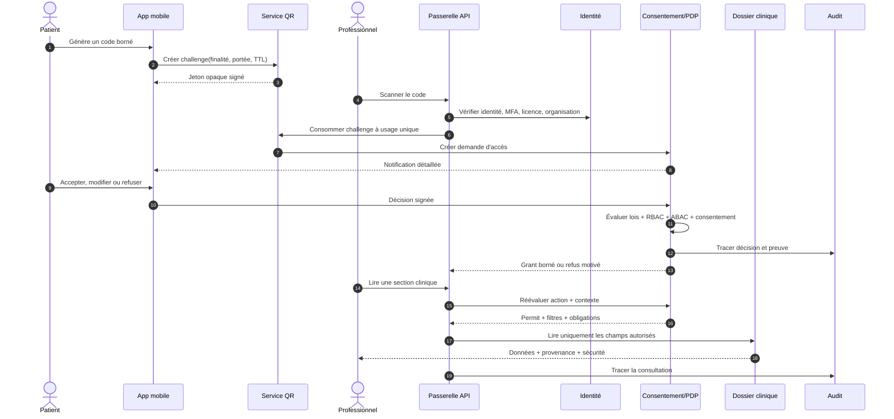

### Menaces et mesures

| Menace | Mesure obligatoire |
|---|---|
| Photo/rejeu du code | usage unique, TTL court, nonce, statut consommé, binding de session |
| Falsification | signature asymétrique, rotation de clés, `kid`, validation stricte |
| Scan par un faux professionnel | authentification forte, preuve d’exercice, affiliation active |
| Hameçonnage du patient | affichage du nom vérifié, organisation, photo/badge si autorisé, code de confirmation visuel |
| Accès excessif | portée minimale, catégories explicites, finalité et durée obligatoires |
| Vol de jeton | DPoP ou mTLS côté partenaire, jetons courts, rotation, détection d’anomalie |
| Accès après révocation | introspection/révocation, cache invalidé par événement haute priorité |
| Corrélation du patient | aucun identifiant stable dans le code, challenges non prédictibles |

## 2.7 Moteur de consentement et d’autorisation

### Modèle de décision

Une décision se calcule sur le tuple :

`Décision = f(sujet, patient, mandataire, ressource, action, finalité, rôle, relation, organisation, localisation, temps, sensibilité, juridiction, consentement, obligation légale, risque)`

Ordre de priorité recommandé :

1. interdiction légale ou clinique absolue;
2. obligation légale/urgence explicitement autorisée;
3. statut d’identité, de licence et d’organisation;
4. politique institutionnelle et séparation des fonctions;
5. consentement ou délégation valide;
6. restrictions patient plus spécifiques;
7. règle de moindre privilège et filtre de champs;
8. obligations attachées à la réponse : masquage, filigrane, interdiction d’export, notification, revue.

### Portée d’un consentement

- bénéficiaire : professionnel, équipe, organisation, rôle ou proche;
- patient concerné et autorité du signataire;
- finalité : traitement, paiement, opérations, urgence, recherche, accompagnement;
- actions : voir, télécharger, annoter, créer, modifier, transmettre, imprimer;
- catégories : allergies, médicaments, laboratoire, imagerie, santé mentale, génétique, santé sexuelle, finances, etc.;
- période clinique des données et période de validité du consentement;
- lieu, épisode de soins ou organisation;
- exclusions par ressource, auteur, code, sensibilité;
- obligations : notification, justification, pas de rediffusion, chiffrement, filigrane;
- base juridique et politique applicables;
- preuve : texte présenté, version, langue, canal, horodatage et signature.

### États

`DRAFT → PROPOSED → ACTIVE → SUSPENDED → EXPIRED | REVOKED | REJECTED | SUPERSEDED`

Toute modification substantielle crée une nouvelle version et remplace l’ancienne. La révocation n’efface pas les preuves ni les accès antérieurs licites; elle bloque les accès futurs, sauf conservation déjà imposée ou exception légale.

### Partage avec un proche

- invitation nominative, vérification d’identité et acceptation;
- relation et fondement : choix du patient, tutelle, mandat, responsabilité parentale;
- portée et durée distinctes de celles des professionnels;
- interdiction de redélégation par défaut;
- journal séparant les actions du proche de celles du patient;
- mécanisme de conflit et de retrait immédiat;
- règles d’âge et de capacité paramétrables par juridiction.

## 2.8 Consultation du dossier

### Sections accessibles

Synthèse, allergies, médicaments, problèmes, antécédents, vaccinations, laboratoire, imagerie, procédures, hospitalisations, plans de soins, constantes, santé mentale, génétique, santé reproductive, réadaptation, nutrition, documents, messages cliniques et facturation. Chaque section peut être totalement visible, masquée, limitée à une période, limitée à des codes ou limitée au résumé.

### Niveaux de confidentialité

| Niveau | Exemples | Contrôles |
|---|---|---|
| C0 — public administratif | coordonnées publiées d’une clinique | accès public contrôlé |
| C1 — interne | données opérationnelles non cliniques | rôle et organisation |
| C2 — santé standard | consultations, résultats courants | relation + finalité + consentement/politique |
| C3 — sensible | santé mentale, sexuelle, dépendance, violence | consentement explicite, filtrage, audit renforcé |
| C4 — très sensible | génétique, psychothérapie protégée, VIH selon juridiction | règle spécifique, MFA récent, pas d’export par défaut |
| C5 — secret système | clés, secrets, données d’authentification | coffre de secrets, jamais exposé aux applications |

### Règles métier

- **RM-ACC-001** : un QR valide initie une demande; il n’accorde jamais seul un accès.
- **RM-ACC-002** : tout accès doit avoir une finalité codée et affichable au patient.
- **RM-ACC-003** : l’autorisation est refusée par défaut en cas d’indétermination.
- **RM-ACC-004** : la portée effective est l’intersection des droits professionnels, de la politique, du consentement et du besoin minimal.
- **RM-ACC-005** : une révocation active doit être appliquée à tout nouveau contrôle en moins de 60 secondes.
- **RM-ACC-006** : la lecture d’une ressource C3/C4 exige une trace au niveau de la ressource et, si requis, du champ.
- **RM-ACC-007** : l’accès d’urgence exige justification structurée + texte libre, MFA récent et revue.
- **RM-ACC-008** : une donnée masquée ne doit pas être inférable via recherche, compteurs, exports ou notifications.
- **RM-ACC-009** : les administrateurs techniques voient des identifiants pseudonymisés sauf élévation approuvée.
- **RM-ACC-010** : l’absence de consentement explicite ne doit pas être assimilée à un refus lorsqu’une autre base légale s’applique; la base doit être enregistrée.

## 2.9 Prescriptions

### Cycle de vie

`BROUILLON → À_VALIDER → SIGNÉE → TRANSMISE → PARTIELLEMENT_SERVIE → SERVIE → TERMINÉE`  
Branches : `REFUSÉE`, `ANNULÉE`, `EXPIRÉE`, `REMPLACÉE`, `EN_ERREUR`.

### Fonctions

- création à partir d’un catalogue normalisé ou d’un protocole;
- vérification patient, prescripteur, licence, allergies, duplications, interactions, dose et grossesse;
- prescription simple, composée, PRN, décroissance, protocole et dispositif;
- signature numérique et horodatage;
- transmission à une pharmacie choisie;
- renouvellement demandé par patient/pharmacien puis approuvé ou refusé;
- substitution et clarification documentées;
- annulation avec notification des destinataires;
- rapprochement médicamenteux et historique complet;
- séparation entre ordonnance, dispensation et administration.

### Règles métier

- **RM-RX-001** : seul un prescripteur autorisé dans la juridiction et pour la classe peut signer.
- **RM-RX-002** : une ordonnance signée est immuable; une correction la remplace avec lien de version.
- **RM-RX-003** : chaque ligne contient dose, voie, fréquence, durée/quantité et instructions, ou une justification d’absence.
- **RM-RX-004** : les alertes critiques doivent être résolues ou justifiées avant signature.
- **RM-RX-005** : la signature couvre l’empreinte canonique de toutes les lignes et pièces jointes.
- **RM-RX-006** : un renouvellement ne réactive jamais automatiquement une prescription expirée sans décision clinique.

## 2.10 Résultats de laboratoire

### Canaux d’entrée

- FHIR `ServiceRequest`, `Specimen`, `Observation`, `DiagnosticReport`;
- HL7 v2 ORM/ORU via moteur d’interface;
- CDA/document structuré;
- PDF natif;
- image/PDF numérisé avec OCR;
- saisie contrôlée par un laboratoire autorisé.

### Pipeline

1. quarantaine antivirus et validation de format;
2. identification de l’émetteur et vérification de signature;
3. rapprochement déterministe/probabiliste patient, commande et spécimen;
4. parsing, validation de schéma et normalisation LOINC/UCUM;
5. contrôles de cohérence, unités, références, doublons et correction;
6. revue humaine si confiance insuffisante ou OCR;
7. validation/signature laboratoire;
8. détection de criticité et acheminement;
9. publication professionnelle/patient selon politique;
10. historisation et provenance.

### Règles métier

- **RM-LAB-001** : un résultat OCR reste `PRELIMINARY_UNVERIFIED` jusqu’à validation humaine.
- **RM-LAB-002** : le PDF original est conservé avec empreinte même après extraction structurée.
- **RM-LAB-003** : toute correction conserve la valeur antérieure et le motif.
- **RM-LAB-004** : les unités sont stockées telles que reçues et, si converties, avec valeur/unité normalisées séparées.
- **RM-LAB-005** : un résultat critique déclenche un workflow d’accusé; une notification push seule ne constitue pas une prise en charge.
- **RM-LAB-006** : les valeurs provisoires, finales, corrigées et annulées sont visuellement distinctes.

## 2.11 Imagerie médicale

- ordonnance et justification clinique;
- rendez-vous d’examen et préparation;
- métadonnées DICOM : Study/Series/SOP Instance UID;
- stockage objet/PACS/VNA, pas de BLOB DICOM dans la base relationnelle;
- visualiseur DICOMweb `QIDO-RS`, `WADO-RS`, `STOW-RS` avec jetons courts;
- compte rendu structuré, impression, conclusion et addenda;
- dose et produit de contraste;
- partage externe par lien borné;
- anonymisation/pseudonymisation pour recherche distincte;
- conservation des objets originaux et de leur empreinte.

## 2.12 Rendez-vous, téléconsultation et communication

- types de rendez-vous, ressources, lieux, listes d’attente, rappels et motifs;
- règles de disponibilité, durée, délai minimal, annulation et non-présentation;
- préadmission, questionnaires et vérification du consentement;
- salle d’attente virtuelle, qualité réseau, présence et interprète;
- vidéo WebRTC chiffrée; aucune captation par défaut;
- partage de document, notes de consultation et ordonnance post-visite;
- messagerie sécurisée liée à un patient et éventuellement à un épisode;
- SLA, escalade, absence du bureau et distinction message/urgence.

## 2.13 Facturation et assurances

- vérification d’admissibilité;
- devis/estimation et consentement financier;
- actes, diagnostics de facturation et tarifs;
- facture, taxes si applicables, paiements, remboursements;
- demande de règlement, pièces justificatives, statut et motifs de rejet;
- coordination de plusieurs assureurs;
- rapprochement des paiements;
- séparation stricte des finalités soins/paiement dans le moteur d’accès.

## 2.14 User Stories prioritaires et critères d’acceptation

### US-01 — Générer un accès ponctuel

**En tant que** patient, **je veux** créer un QR valable dix minutes pour mes allergies, médicaments et résultats récents **afin de** consulter un professionnel sans partager tout mon dossier.

**Critères :**

- Étant donné un patient authentifié et un MFA récent, lorsque le QR est créé, alors il ne contient aucune donnée de santé ni identifiant permanent.
- Après un premier scan valide, toute réutilisation est refusée et auditée.
- Sans décision du patient avant expiration, aucun accès standard n’est créé.
- Le patient peut réduire la portée demandée avant d’accepter.

### US-02 — Accorder un accès permanent au médecin traitant

**En tant que** patient, **je veux** autoriser mon médecin traitant jusqu’à révocation **afin de** faciliter mon suivi.

**Critères :**

- La relation, l’identité, la licence et l’affiliation sont vérifiées.
- Le patient choisit les catégories et reçoit un rappel périodique de revue.
- Une suspension de licence bloque l’accès même si le consentement demeure actif.
- La révocation s’applique aux nouveaux accès dans le SLA de 60 secondes.

### US-03 — Comprendre un accès

**En tant que** patient, **je veux** voir qui a consulté mes données **afin de** détecter un usage injustifié.

**Critères :** identité, organisation, date, finalité, catégories, base d’autorisation et mode normal/urgence sont affichés; un signalement peut être ouvert à partir de l’événement; les détails techniques sensibles ne sont pas exposés.

### US-04 — Bris de glace

**En tant qu’** urgentiste, **je veux** accéder aux données vitales d’un patient incapable de répondre **afin de** le traiter en sécurité.

**Critères :** rôle admissible, MFA récent, justification, durée courte, périmètre minimal, notification et revue a posteriori obligatoires; toute extension de portée exige une nouvelle décision.

### US-05 — Signer une prescription

**En tant que** prescripteur, **je veux** signer une ordonnance validée **afin de** la transmettre sans ambiguïté.

**Critères :** licence active; alertes critiques résolues; empreinte de la version signée; interdiction de modification en place; preuve et statut de transmission visibles.

### US-06 — Importer un résultat PDF

**En tant que** laboratoire, **je veux** déposer un rapport PDF **afin de** l’intégrer au dossier.

**Critères :** analyse antivirus; empreinte; rapprochement patient; OCR avec score; validation humaine sous seuil; conservation du document original; provenance et statut visibles.

### US-07 — Corriger un résultat

**En tant que** biologiste, **je veux** corriger un résultat final **afin de** réparer une erreur sans perdre la trace.

**Critères :** nouvelle version; motif obligatoire; ancienne version conservée; destinataires avisés; rapport corrigé lié à l’original; audit complet.

### US-08 — Déléguer à un proche

**En tant que** patient, **je veux** déléguer la gestion de mes rendez-vous à mon conjoint sans lui montrer ma santé mentale **afin de** recevoir de l’aide en préservant ma vie privée.

**Critères :** identité du proche vérifiée; permissions fonctionnelles et catégories distinctes; santé mentale non inférable; révocation immédiate; actions attribuées au proche.

### US-09 — Recevoir un résultat critique

**En tant que** clinicien responsable, **je veux** recevoir et accuser un résultat critique **afin de** déclencher rapidement le suivi.

**Critères :** escalade multi-canal; accusé nominatif; chronomètre SLA; transfert documenté; clôture avec action; impossibilité de clore par simple lecture.

### US-10 — Exporter le dossier

**En tant que** patient, **je veux** exporter mes données **afin de** les transférer.

**Critères :** MFA récent; aperçu de portée; export asynchrone chiffré; lien court; FHIR + documents; journalisation; exclusion expliquée des données légalement non exportables.

### US-11 — Consulter hors ligne une carte d’urgence

**En tant que** patient, **je veux** une carte d’urgence minimale **afin de** rendre disponibles mes informations vitales lors d’une panne.

**Critères :** activation explicite; contenu minimal choisi; signature vérifiable; date de fraîcheur visible; révocation possible; aucune donnée C4 par défaut.

### US-12 — Contester un accès

**En tant que** patient, **je veux** signaler une consultation suspecte **afin de** demander une enquête.

**Critères :** création d’un dossier d’incident lié à l’audit; accusé; suivi d’état; restriction des détails d’enquête; conservation légale; notification finale appropriée.

## 2.15 Règles transversales

- **RM-DAT-001** : toutes les dates cliniques conservent l’instant UTC, le fuseau et, si fourni, l’heure locale source.
- **RM-DAT-002** : les codes cliniques conservent système, version, code, libellé affiché et éventuel mapping.
- **RM-DAT-003** : toute donnée clinique indique `source_type`, `source_id`, `author`, `organization`, `recorded_at`, `verification_status`.
- **RM-DAT-004** : une donnée patient ne remplace pas silencieusement une donnée professionnelle; elles peuvent coexister.
- **RM-DAT-005** : les doublons sont rapprochés, jamais supprimés avant adjudication.
- **RM-DAT-006** : une ressource signée est immuable; correction par addenda ou nouvelle version.
- **RM-ID-001** : aucun rapprochement patient définitif ne repose sur un seul identifiant faible.
- **RM-ID-002** : toute fusion de patient est réversible et auditée.
- **RM-NOT-001** : les notifications externes ne contiennent pas de détail clinique sensible.
- **RM-RET-001** : conservation et purge sont pilotées par type, juridiction, âge, litige et obligation professionnelle.

---

# 3. Architecture applicative

## 3.1 Domaines fonctionnels délimités

| Domaine | Responsabilité | Données maîtresses |
|---|---|---|
| Tenant & organisation | locataires, établissements, lieux, configurations | organisation, site, juridiction |
| IAM | identités, authentification, sessions, appareils | compte, facteur, rôle |
| MPI patient | identité, rapprochement, fusion | patient, identifiant, lien |
| Répertoire professionnel | licences, spécialités, affiliations | professionnel, qualification |
| Consentement & politique | demandes, décisions, délégations, PDP | consentement, grant, policy |
| Dossier clinique | rencontres, problèmes, allergies, plans | ressource clinique canonique |
| Médicament | prescription, dispensation, administration | ordonnance, médicament |
| Diagnostic | laboratoire, imagerie, résultats | observation, rapport, étude |
| Planification | rendez-vous, ressources, listes d’attente | rendez-vous, disponibilité |
| Collaboration | tâches, messages, notifications | conversation, message, tâche |
| Documents & signature | objets, versions, signatures | document, signature |
| Facturation | couverture, factures, réclamations | police, facture, claim |
| IoT | appareils et mesures | appareil, mesure |
| Interopérabilité | adaptateurs, mapping, files, FHIR | endpoint, mapping, message |
| Audit & conformité | événements, incidents, droits, conservation | audit, dossier de conformité |

## 3.2 Option A — Microservices

### Description

Chaque domaine est déployé indépendamment, possède sa base ou son schéma, publie des événements et communique par API synchrones pour les lectures immédiates et par bus pour la propagation.

### Avantages

- déploiement et mise à l’échelle indépendants;
- isolation des pannes et des données sensibles;
- autonomie des équipes et cycles de livraison distincts;
- technologies spécialisées possibles : FHIR, recherche, règles, imagerie.

### Risques

- transactions distribuées, cohérence éventuelle et débogage plus difficiles;
- multiplication des contrats, versions, certificats, secrets et pipelines;
- latence et disponibilité composées;
- coût organisationnel élevé avant que les équipes et volumes ne le justifient;
- risque de microservices « distribués mais couplés ».

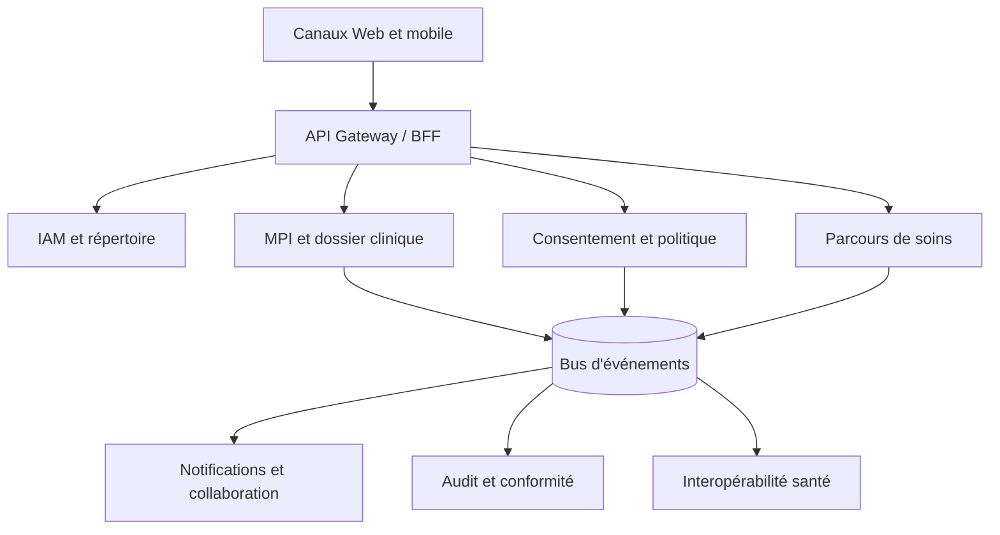

## 3.3 Option B — Monolithe modulaire

### Description

Une unité de déploiement principale contient des modules métier strictement séparés. Chaque module expose des interfaces internes, possède ses tables et ses migrations, et communique au moyen de commandes, requêtes et événements internes. Les workers, la passerelle d’intégration, l’imagerie et l’analytique peuvent être séparés dès le départ.

### Avantages

- transactions locales et cohérence simples;
- développement, tests et exploitation plus rapides;
- latence réduite;
- coûts d’infrastructure et d’observabilité inférieurs;
- frontières de domaine préparant une extraction future.

### Risques

- discipline d’architecture indispensable pour éviter les dépendances croisées;
- déploiement global du cœur applicatif;
- mise à l’échelle moins fine;
- impact potentiel plus large d’une fuite de mémoire ou d’un déploiement défectueux.

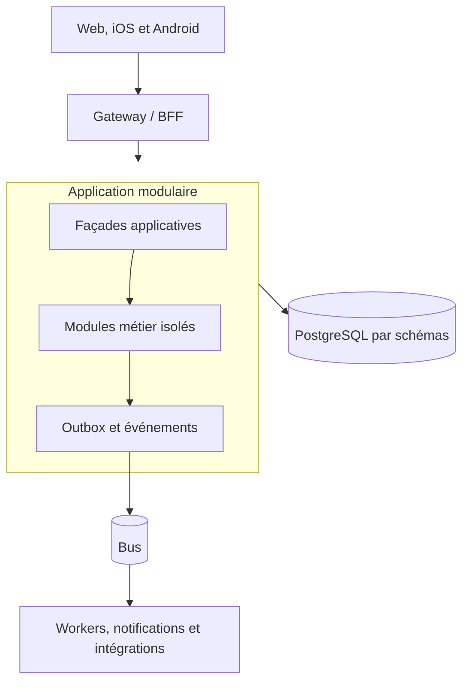

## 3.4 Comparaison

| Critère | Microservices | Monolithe modulaire |
|---|---:|---:|
| Vitesse MVP | 2/5 | 5/5 |
| Complexité opérationnelle | 1/5 | 4/5 |
| Transactions cliniques | 3/5 | 5/5 |
| Échelle indépendante | 5/5 | 3/5 |
| Isolation des pannes | 4/5 | 3/5 |
| Autonomie de nombreuses équipes | 5/5 | 3/5 |
| Coût initial | 2/5 | 5/5 |
| Évolution long terme | 5/5 si bien gouverné | 4/5 si frontières strictes |
| Risque global au démarrage | élevé | modéré |

## 3.5 Recommandation

Adopter un **monolithe modulaire orienté domaines**, complété dès le départ par des composants séparés pour : IAM externe, moteur de politique, stockage documentaire/objet, passerelle d’interopérabilité, traitement asynchrone, recherche, audit immuable et observabilité.

Les modules utilisent :

- schémas de base distincts et interdiction de jointures sauvages intermodules;
- API internes et événements de domaine versionnés;
- pattern Outbox/Inbox et idempotence;
- tests d’architecture automatisés;
- propriétaires de données clairement désignés;
- extraction progressive selon des seuils objectifs.

### Critères d’extraction d’un microservice

- charge ou disponibilité très différente du cœur;
- équipe autonome et rythme de changement élevé;
- exigences d’isolation réglementaire;
- frontière stable avec peu de transactions distribuées;
- gain mesurable supérieur au coût d’exploitation;
- besoin de technologie spécialisée.

Premiers candidats : notifications, documents, IoT, interopérabilité, audit, recherche, imagerie et moteur de consentement/politique.

## 3.6 Patterns applicatifs

- DDD et contextes délimités;
- architecture hexagonale/ports-adaptateurs;
- CQRS léger : modèles de lecture optimisés sans duplication systématique des écritures;
- événements de domaine et d’intégration distincts;
- Saga orchestrée pour prescriptions, résultats critiques et demandes d’accès;
- Outbox transactionnelle, Inbox, déduplication et clés d’idempotence;
- API contract-first OpenAPI/FHIR CapabilityStatement;
- strangler pattern lors de l’extraction de services;
- feature flags audités et configuration par juridiction;
- aucune logique clinique critique dans le frontend.

## 3.7 Flux événementiel principal

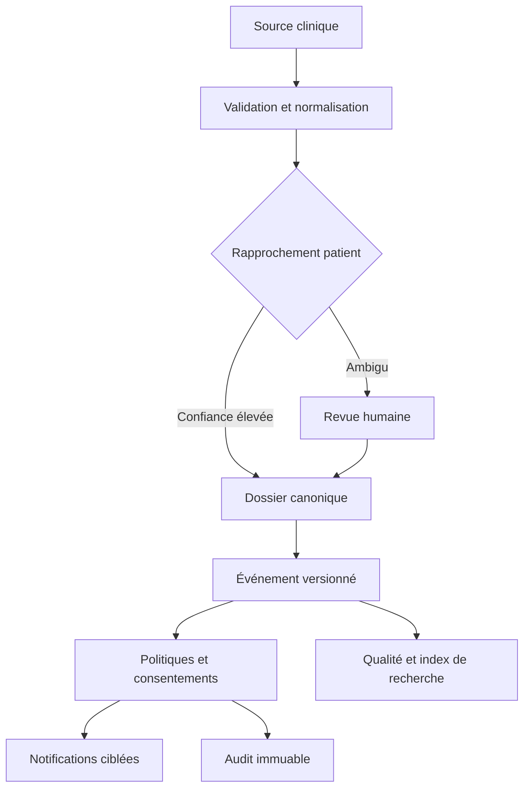

---

# 4. Architecture technique

## 4.1 Vue logique cible


## 4.2 Frontend Web

Recommandation : application TypeScript avec framework SSR/SPA mature (React/Next.js ou Angular), design system clinique et BFF dédié.

- rendu serveur pour pages publiques; espace authentifié en SPA/PWA;
- aucun jeton longue durée dans `localStorage`; session BFF avec cookie `HttpOnly`, `Secure`, `SameSite`;
- CSP stricte, Trusted Types, protection CSRF, SRI, dépendances contrôlées;
- masquage lors du changement d’onglet sur poste partagé configurable;
- accessibilité WCAG 2.2 AA, navigation clavier, contraste, textes adaptatifs;
- graphiques cliniques accompagnés d’une table et des unités;
- internationalisation et formats locaux;
- télémétrie sans PHI dans les outils non cliniques.

## 4.3 Applications mobiles

Options : Swift/Kotlin natifs pour exigences maximales, ou Flutter/React Native avec modules natifs de sécurité. Une architecture multiplateforme est acceptable si les contrôles biométriques, le stockage sécurisé, l’attestation et les notifications sont correctement implémentés.

- OAuth Authorization Code + PKCE via navigateur système;
- stockage des secrets dans Keychain/Keystore;
- biométrie locale comme facteur de déverrouillage, non comme identité distante unique;
- détection d’appareil compromis et attestation graduée;
- certificate pinning avec stratégie de rotation;
- cache hors ligne minimal, chiffré, expirant et effaçable à distance;
- capture d’écran désactivée sur vues C4 lorsque la plateforme le permet;
- deep links signés, protection contre overlays et journaux sans PHI;
- push contenant seulement un avis générique.

## 4.4 Backend et API Gateway

Technologies possibles : .NET 10/ASP.NET Core, Java 25/Spring Boot ou Kotlin. Pour une équipe Microsoft, .NET constitue un choix cohérent; le modèle demeure technologiquement neutre.

La passerelle assure : terminaison TLS, validation JWT, DPoP/mTLS selon client, quota, limitation, vérification de taille, protection BOLA de premier niveau, routage, corrélation, version, transformation non clinique et journalisation minimale. L’autorisation métier reste dans le service et le PDP; la Gateway ne suffit jamais.

Le BFF patient et le BFF professionnel exposent des vues adaptées et réduisent le risque de surexposition. Les API partenaires sont séparées et soumises à des contrats, certificats, scopes et quotas propres.

## 4.5 Identité et authentification

- fournisseur OIDC certifié, séparation des realms patient/professionnel/administration;
- fédération avec identités gouvernementales et institutionnelles lorsqu’elles sont disponibles;
- MFA résistant à l’hameçonnage : WebAuthn/passkeys ou clés FIDO2; TOTP de secours; SMS seulement en dernier recours;
- niveaux d’assurance : AAL1 information générale, AAL2 données cliniques, AAL3 administration critique/bris de glace selon risque;
- step-up pour QR sensible, export, signature, délégation et changement de coordonnées;
- SCIM pour le cycle de vie des travailleurs;
- session courte, rotation des refresh tokens, détection de réutilisation;
- récupération de compte conçue contre l’ingénierie sociale;
- comptes de service avec workload identity, jamais de secrets statiques si évitable.

## 4.6 Données et stockage

| Besoin | Technologie logique | Règle |
|---|---|---|
| Transactions | PostgreSQL ou SQL Server HA | ACID, chiffrement, RLS en défense supplémentaire |
| Documents | stockage objet WORM/versionné | empreinte, antivirus, chiffrement par enveloppe |
| Imagerie | PACS/VNA + DICOMweb | UIDs et métadonnées en relationnel, pixels en objet |
| Recherche | OpenSearch/Elasticsearch privé | index minimisé, filtrage de sécurité, pas de source de vérité |
| Cache | Redis privé | données minimales, TTL court, chiffrement, invalidation de consentement |
| Événements | Kafka/Event Hubs/Pub/Sub | partitions, schéma versionné, rétention, DLQ |
| Audit | journal append-only + stockage immuable | chaînage d’empreintes, accès séparé |
| Analytique | lac/entrepôt pseudonymisé | finalité et gouvernance distinctes |

## 4.7 Cloud, réseau et résilience

La solution doit être déployable sur un cloud majeur ou un environnement souverain répondant aux exigences locales. Le choix final dépend du pays d’hébergement, du rôle juridique et des certifications requises.

- deux ou trois zones de disponibilité par région;
- réseau privé, endpoints privés, aucun accès direct public aux bases;
- séparation comptes/abonnements production, sécurité, journalisation et sauvegarde;
- Kubernetes managé ou PaaS conteneurisé; éviter Kubernetes si l’équipe ne peut l’opérer;
- infrastructure as code, images signées, SBOM, admission policy;
- sauvegardes chiffrées, immuables, testées; copie séparée contre rançongiciel;
- région secondaire avec données conformes à la résidence;
- tests semestriels de reprise et exercices de crise;
- mode dégradé pour urgence et lecture de synthèses préautorisées.

### Objectifs non fonctionnels

| Composant | SLO disponibilité | Latence cible p95 | RPO | RTO |
|---|---:|---:|---:|---:|
| Accès synthèse clinique | 99,95 % | < 800 ms hors documents | 5 min | 60 min |
| Décision d’autorisation | 99,99 % | < 100 ms cache chaud | quasi nul | 15 min |
| Prescription/signature | 99,95 % | < 1,5 s | 0–5 min | 60 min |
| Notifications | 99,9 % | 95 % < 60 s | 15 min | 4 h |
| Imports partenaires | 99,9 % | asynchrone | 15 min | 4 h |
| Imagerie | 99,9 % | progressive | 15 min | 4 h |
| Audit | 99,99 % en écriture | < 200 ms asynchrone garanti | 0 | 15 min |

## 4.8 Messagerie et traitement asynchrone

- événements CloudEvents/Avro/JSON Schema versionnés;
- ordre garanti uniquement par agrégat lorsque nécessaire;
- Outbox dans la même transaction que le changement métier;
- consommateurs idempotents, Inbox et `event_id` unique;
- reprise exponentielle avec jitter, DLQ, quarantaine et console de réexécution;
- aucun contenu C4 dans les métadonnées de routage;
- événements d’invalidation de consentement prioritaires;
- corrélation et causalité : `trace_id`, `correlation_id`, `causation_id`.

## 4.9 Observabilité

- OpenTelemetry traces, métriques et logs structurés;
- identifiants pseudonymisés; filtre automatique de PHI/PII;
- tableaux SLO, latence PDP, files, imports, rapprochement et fraîcheur;
- SIEM séparé, règles UEBA, alertes de consultation massive ou inhabituelle;
- synthetic monitoring sans patient réel;
- profiling désactivé ou expurgé en production;
- accès aux logs soumis au moindre privilège et audité;
- rétention différenciée des logs techniques et des preuves d’audit.

## 4.10 Environnements et chaîne de livraison

- environnements isolés; aucune donnée réelle en développement/test;
- jeux synthétiques respectant les cas cliniques;
- SAST, SCA, secret scanning, IaC scanning, DAST et tests API;
- revue à deux personnes pour politiques, migrations et cryptographie;
- artefacts immuables promus, non recompilés;
- canary/blue-green, migrations rétrocompatibles, rollback testé;
- séparation des fonctions développeur/opérateur/auditeur;
- pentest annuel et après changement majeur; programme de divulgation coordonnée.

---

# 5. Modélisation de la base de données

## 5.1 Principes de modélisation

Le modèle transactionnel est relationnel, normalisé et réparti en schémas par domaine. Les ressources FHIR exposées ne sont pas stockées uniquement sous forme de JSON : les champs décisionnels sont relationnels et indexables; une représentation canonique JSON versionnée peut être conservée pour l’échange et la preuve.

### Conventions communes

Sauf indication contraire, toute table métier possède :

- `id uuid NOT NULL` — clé primaire générée en UUIDv7;
- `tenant_id uuid NOT NULL` — FK vers `core.tenant(id)`, clé de partition logique;
- `created_at timestamptz NOT NULL`, `created_by uuid NULL`;
- `updated_at timestamptz NOT NULL`, `updated_by uuid NULL`;
- `row_version bigint NOT NULL DEFAULT 1` — concurrence optimiste;
- `source_system_id uuid NULL` et `external_id varchar(150) NULL` pour la provenance;
- `classification smallint NOT NULL DEFAULT 2` — C0 à C5;
- `is_deleted boolean NOT NULL DEFAULT false` uniquement pour les agrégats où une suppression logique est licite.

Les tables d’audit, événements, signatures, versions cliniques et preuves sont **append-only** et n’ont pas `is_deleted`. Les documents binaires, images DICOM et données génomiques brutes ne résident pas dans la base relationnelle; celle-ci stocke URI privée, empreinte, type, taille et clé de chiffrement enveloppée.

### Types et règles

| Élément | Standard |
|---|---|
| Identifiant | UUIDv7; identifiant externe jamais utilisé comme PK |
| Temps | `timestamptz` UTC + `source_timezone varchar(64)` si contexte local nécessaire |
| Codes | `code`, `system_uri`, `system_version`, `display` ou FK vers `ref.concept` |
| Montants | `numeric(19,4)` + `char(3)` ISO 4217 |
| Mesures | valeur originale + unité UCUM; valeur normalisée séparée |
| Téléphone | E.164 chiffré + suffixe/index HMAC pour recherche exacte |
| Courriel | valeur chiffrée + empreinte normalisée HMAC |
| Secrets | jamais stockés en clair; références au coffre de secrets |
| Texte clinique | `text`, chiffrement applicatif pour C3/C4 selon menace |
| JSON | `jsonb` uniquement pour extensions, snapshots et données non décisionnelles |

### Stratégie d’historisation

- **Version clinique** : `business_key`, `version_no`, `status`, `supersedes_id`, `valid_from`, `valid_to`; une version signée est immuable.
- **Données administratives** : temporalité système et, si nécessaire, validité métier.
- **Consentement** : chaque version conserve le texte, les règles compilées et la preuve.
- **Audit** : événements append-only, chaînés par lot avec empreinte et ancrage externe périodique.
- **Suppression** : orchestration par politique de conservation; tombstone et preuve de purge, sans conserver le contenu supprimé.

## 5.2 MCD — vue d’ensemble

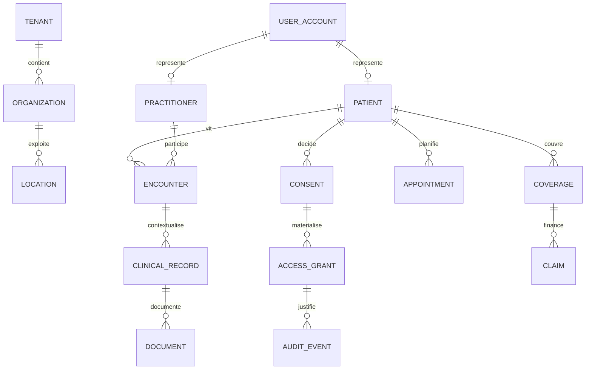

## 5.3 MLD — dépendances principales

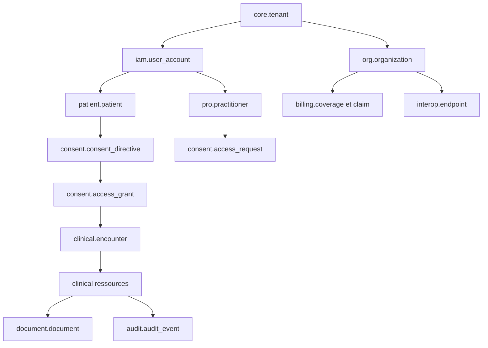

## 5.4 Schémas relationnels et catalogue des tables

Les index mentionnés s’ajoutent à la PK. Tous les index métier commencent par `tenant_id`. Les FK cliniques utilisent `RESTRICT`; les données dépendantes purement techniques peuvent utiliser `CASCADE`. Les identifiants sensibles sont chiffrés et recherchés par empreinte HMAC, jamais par chiffrement déterministe seul.

### 5.4.1 Schéma `core` — plateforme et multitenance

| Table | Description et colonnes spécifiques | PK/FK et contraintes | Index recommandés |
|---|---|---|---|
| `core.tenant` | Locataire : `code varchar(50)`, `name varchar(200)`, `status varchar(20)`, `default_jurisdiction_id uuid`, `data_region varchar(50)`, `settings jsonb` | PK `id`; UQ `code`; FK juridiction | UQ `(code)`; `(status, data_region)` |
| `core.tenant_domain` | Domaines validés : `tenant_id`, `domain varchar(253)`, `verified_at`, `verification_method` | PK `id`; FK tenant; UQ `domain` | UQ `(lower(domain))` |
| `core.jurisdiction` | Pays/province/État : `code varchar(20)`, `country_code char(2)`, `parent_id`, `timezone`, `effective_from/to` | PK; FK parent self; UQ `(country_code,code)` | `(parent_id)`, période |
| `core.feature_flag` | Fonction par tenant : `key varchar(100)`, `enabled`, `rules jsonb`, `effective_from/to` | PK; FK tenant; UQ `(tenant_id,key,effective_from)` | `(key,enabled)` |
| `core.configuration` | Paramètre non secret : `scope_type`, `scope_id`, `key`, `value jsonb`, `schema_version` | PK; CK scope; UQ `(tenant_id,scope_type,scope_id,key)` | UQ fonctionnel |
| `core.legal_text` | Texte légal versionné : `type`, `locale`, `version`, `content_uri`, `content_hash bytea`, `effective_at`, `retired_at` | PK; UQ `(tenant_id,type,locale,version)`; hash obligatoire | `(type,locale,effective_at)` |
| `core.acceptance_record` | Acceptation : `legal_text_id`, `actor_user_id`, `accepted_at`, `channel`, `evidence_hash`, `ip_prefix` | PK; FK texte/utilisateur; append-only | `(actor_user_id,accepted_at DESC)`, `(legal_text_id)` |
| `core.sequence_registry` | Séquences lisibles : `sequence_key`, `next_value bigint`, `prefix`, `year_scope` | PK composite tenant/key; CK next>0 | UQ `(tenant_id,sequence_key,year_scope)` |

### 5.4.2 Schéma `iam` — identité, authentification et privilèges

| Table | Description et colonnes spécifiques | PK/FK et contraintes | Index recommandés |
|---|---|---|---|
| `iam.user_account` | Compte : `subject varchar(150)`, `account_type`, `status`, `locale`, `last_login_at`, `locked_until` | PK; UQ `(tenant_id,subject)`; CK type/status | `(status)`, `(last_login_at)` |
| `iam.user_identity` | Identité fédérée : `user_id`, `issuer`, `provider_subject`, `assurance_level`, `verified_at` | PK; FK user; UQ `(issuer,provider_subject)` | `(user_id)`, UQ fédérée |
| `iam.credential_factor` | Facteur : `user_id`, `factor_type`, `credential_ref`, `public_key`, `status`, `enrolled_at`, `last_used_at` | PK; FK user; secret externe; UQ ref | `(user_id,status)` |
| `iam.recovery_method` | Récupération : `user_id`, `method_type`, `value_hmac`, `verified_at`, `status` | PK; FK user; pas de valeur claire | `(user_id,status)`, `(value_hmac)` |
| `iam.device` | Appareil : `user_id`, `device_fingerprint_hmac`, `platform`, `attestation_level`, `trusted_until`, `revoked_at` | PK; FK user; UQ empreinte active | `(user_id,revoked_at)`, `(trusted_until)` |
| `iam.session` | Session : `user_id`, `device_id`, `started_at`, `expires_at`, `last_seen_at`, `risk_score numeric(5,2)`, `revoked_at` | PK; FK user/device; CK expiration | `(user_id,expires_at)`, `(revoked_at)` |
| `iam.role` | Rôle : `code`, `name`, `role_type`, `description`, `system_role boolean` | PK; UQ `(tenant_id,code)` | `(role_type)` |
| `iam.permission` | Permission atomique : `code`, `resource_type`, `action`, `description` | PK; UQ `code` | `(resource_type,action)` |
| `iam.role_permission` | Liaison : `role_id`, `permission_id`, `effect`, `conditions jsonb` | PK composite; FK rôle/permission; CK effect | `(permission_id)` |
| `iam.user_role_assignment` | Attribution : `user_id`, `role_id`, `organization_id`, `valid_from/to`, `approved_by`, `status` | PK; FK; pas de chevauchement actif optionnel | `(user_id,status)`, `(organization_id,role_id)` |
| `iam.service_principal` | Client machine : `client_id`, `name`, `owner_org_id`, `auth_method`, `status`, `jwks_uri` | PK; UQ client_id; FK org | `(owner_org_id,status)` |
| `iam.service_scope` | Scopes client : `service_principal_id`, `scope`, `valid_from/to`, `approved_by` | PK; FK SP; UQ actif | `(service_principal_id)` |
| `iam.login_event` | Authentification : `user_id`, `occurred_at`, `outcome`, `factor_types`, `risk_score`, `network_hmac`, `reason_code` | PK; append-only; FK user nullable | `(user_id,occurred_at DESC)`, `(outcome,occurred_at)` |

### 5.4.3 Schéma `patient` — identité patient et relations

| Table | Description et colonnes spécifiques | PK/FK et contraintes | Index recommandés |
|---|---|---|---|
| `patient.patient` | Identité maître : `user_id`, `status`, `birth_date date`, `deceased_at`, `administrative_sex`, `gender_identity`, `preferred_language`, `identity_confidence` | PK; FK user optionnelle; CK dates/statut | `(user_id)`, `(birth_date,status)` |
| `patient.patient_name` | Noms : `patient_id`, `use`, `family`, `given text[]`, `prefix`, `suffix`, `valid_from/to`, `normalized_hmac` | PK; FK patient; au moins family/given | `(patient_id,use)`, `(normalized_hmac)` |
| `patient.patient_identifier` | Identifiants : `patient_id`, `type`, `system`, `value_ciphertext`, `value_hmac`, `assigner_org_id`, `valid_from/to`, `status` | PK; FK patient/org; UQ `(tenant_id,system,value_hmac)` active | `(patient_id,type)`, UQ HMAC |
| `patient.patient_address` | Adresse : `patient_id`, `use`, lignes chiffrées, `city`, `region`, `postal_hmac`, `country`, `valid_from/to` | PK; FK patient; ISO pays | `(patient_id,use)`, `(region,postal_hmac)` |
| `patient.patient_contact_point` | Téléphone/courriel : `patient_id`, `system`, `use`, `value_ciphertext`, `value_hmac`, `verified_at`, `rank` | PK; FK; UQ valeur active par patient | `(patient_id,system,rank)`, `(value_hmac)` |
| `patient.emergency_contact` | Contact : `patient_id`, `related_person_id`, `name_ciphertext`, `relationship_code`, coordonnées chiffrées, `priority`, `active` | PK; FK patient/related person | `(patient_id,active,priority)` |
| `patient.related_person` | Proche : `user_id`, `birth_date`, `identity_status`, `display_name_ciphertext` | PK; FK user optionnelle | `(user_id)`, `(identity_status)` |
| `patient.patient_relationship` | Relation : `patient_id`, `related_person_id`, `relationship_code`, `authority_type`, `valid_from/to`, `evidence_document_id`, `status` | PK; FK; CK période | `(patient_id,status)`, `(related_person_id,status)` |
| `patient.communication_preference` | Préférences : `patient_id`, `channel`, `purpose`, `locale`, `allowed`, `quiet_hours jsonb` | PK; FK patient; UQ patient/channel/purpose | `(patient_id,purpose)` |
| `patient.accessibility_need` | Besoin : `patient_id`, `type_code`, `description`, `severity`, `accommodation`, `active` | PK; FK patient | `(patient_id,active)` |
| `patient.advance_directive` | Directive : `patient_id`, `directive_type`, `status`, `effective_date`, `document_id`, `custodian_org_id`, `verified_at` | PK; FK patient/document/org | `(patient_id,status,effective_date DESC)` |
| `patient.patient_declaration` | Don d’organes/autres volontés : `patient_id`, `declaration_type`, `value_code`, `effective_from/to`, `evidence_document_id` | PK; FK | `(patient_id,declaration_type)` |
| `patient.patient_link` | MPI : `patient_id`, `other_patient_id`, `link_type`, `confidence`, `status`, `adjudicated_by`, `reason` | PK; FK self; paire ordonnée; pas self-link | `(patient_id,status)`, `(other_patient_id)` |
| `patient.merge_history` | Fusion réversible : `surviving_patient_id`, `merged_patient_id`, `merged_at`, `reason`, `snapshot_uri`, `reversed_at` | PK; FK patients; append-only | `(surviving_patient_id,merged_at)`, `(merged_patient_id)` |
| `patient.identity_match_case` | Revue MPI : `candidate_patient_ids uuid[]`, `score`, `match_features jsonb`, `status`, `assigned_to`, `resolved_at` | PK; CK score 0..1 | `(status,created_at)`, GIN candidats |

### 5.4.4 Schémas `org` et `pro` — organisations et professionnels

| Table | Description et colonnes spécifiques | PK/FK et contraintes | Index recommandés |
|---|---|---|---|
| `org.organization` | Organisation : `parent_id`, `type_code`, `legal_name`, `display_name`, `registration_no_hmac`, `status`, `jurisdiction_id` | PK; FK parent/juridiction; UQ registration HMAC | `(parent_id)`, `(type_code,status)` |
| `org.organization_identifier` | Identifiants : `organization_id`, `system`, `value`, `type`, `valid_from/to` | PK; FK org; UQ system/value | `(organization_id,type)` |
| `org.location` | Lieu : `organization_id`, `parent_id`, `type_code`, `name`, `timezone`, `status`, `physical_type` | PK; FK org/self | `(organization_id,status)`, géospatial si requis |
| `org.location_address` | Adresse : `location_id`, lignes, ville, région, code postal, pays, coordonnées géographiques | PK; FK location | `(location_id)`, index géospatial |
| `org.department` | Département : `organization_id`, `parent_id`, `code`, `name`, `status` | PK; UQ org/code; FK | `(organization_id,parent_id)` |
| `org.healthcare_service` | Service : `organization_id`, `location_id`, `type_code`, `name`, `referral_required`, `virtual_available`, `active` | PK; FK | `(organization_id,type_code,active)` |
| `org.service_schedule` | Horaire : `healthcare_service_id`, `day_of_week`, `start_time`, `end_time`, `effective_from/to` | PK; FK; CK heures | `(healthcare_service_id,day_of_week)` |
| `org.organization_endpoint` | Endpoint métier : `organization_id`, `endpoint_id`, `purpose`, `status` | PK; FK org/interop endpoint; UQ | `(organization_id,purpose)` |
| `pro.practitioner` | Professionnel : `user_id`, `status`, `display_name`, `birth_date`, `professional_type`, `identity_verified_at` | PK; FK user; UQ user | `(professional_type,status)`, `(user_id)` |
| `pro.practitioner_identifier` | Numéro d’ordre : `practitioner_id`, `system`, `value_hmac`, `jurisdiction_id`, `type`, `valid_from/to` | PK; UQ system/value HMAC; FK | `(practitioner_id,type)` |
| `pro.license` | Licence : `practitioner_id`, `license_no_hmac`, `profession_code`, `jurisdiction_id`, `status`, `issued_on`, `expires_on`, `restrictions` | PK; FK; UQ licence/juridiction | `(practitioner_id,status)`, `(expires_on)` |
| `pro.qualification` | Diplôme/certification : `practitioner_id`, `type_code`, `title`, `issuer`, `issued_on`, `expires_on`, `verification_status`, `document_id` | PK; FK | `(practitioner_id,type_code)`, `(expires_on)` |
| `pro.specialty` | Spécialité : `practitioner_id`, `specialty_code`, `is_primary`, `verified_at`, `valid_from/to` | PK; FK; UQ active | `(specialty_code)`, `(practitioner_id,is_primary)` |
| `pro.affiliation` | Affiliation : `practitioner_id`, `organization_id`, `department_id`, `role_code`, `employment_status`, `valid_from/to` | PK; FK; CK période | `(practitioner_id,status)`, `(organization_id,role_code)` |
| `pro.privilege` | Privilège clinique : `affiliation_id`, `privilege_code`, `location_id`, `valid_from/to`, `status`, `approved_by` | PK; FK; UQ actif | `(affiliation_id,status)`, `(privilege_code)` |
| `pro.professional_address` | Coordonnées : `practitioner_id`, `organization_id`, `location_id`, téléphone/courriel, `is_primary` | PK; FK | `(practitioner_id,is_primary)` |
| `pro.availability` | Disponibilité : `practitioner_id`, `location_id`, `day_of_week`, `start_time`, `end_time`, `appointment_type`, `effective_from/to` | PK; FK; CK heures | `(practitioner_id,day_of_week)` |
| `pro.signature_credential` | Certificat : `practitioner_id`, `certificate_ref`, `serial_hmac`, `issuer`, `valid_from/to`, `revoked_at`, `assurance_level` | PK; FK; pas de clé privée | `(practitioner_id,revoked_at)`, `(valid_to)` |
| `pro.verification_check` | Vérification registre : `practitioner_id`, `check_type`, `source`, `checked_at`, `outcome`, `evidence_hash`, `next_due_at` | PK; FK; append-only | `(practitioner_id,checked_at DESC)`, `(next_due_at)` |

### 5.4.5 Schéma `consent` — consentements, demandes et autorisations

| Table | Description et colonnes spécifiques | PK/FK et contraintes | Index recommandés |
|---|---|---|---|
| `consent.consent_directive` | Agrégat : `patient_id`, `grantor_type/id`, `category`, `status`, `current_version_no`, `effective_from/to`, `revoked_at` | PK; FK patient; CK état/période | `(patient_id,status)`, `(effective_to)` |
| `consent.consent_version` | Version : `consent_id`, `version_no`, `policy_text_id`, `language`, `decision`, `purpose_codes text[]`, `compiled_policy jsonb`, `evidence_hash` | PK; FK consent/texte; UQ consent/version; append-only | `(consent_id,version_no DESC)`, GIN purpose |
| `consent.consent_grantee` | Bénéficiaire : `consent_version_id`, `grantee_type`, `practitioner_id`, `organization_id`, `related_person_id`, `role_code` | PK; FK; exactement une cible ou rôle | `(practitioner_id)`, `(organization_id)`, `(related_person_id)` |
| `consent.consent_scope` | Portée : `consent_version_id`, `resource_type`, `category_code`, `action`, `clinical_from/to`, `security_labels text[]` | PK; FK; action contrôlée | `(consent_version_id)`, GIN labels |
| `consent.consent_exclusion` | Exclusion : `consent_version_id`, `resource_id`, `code`, `author_id`, `organization_id`, `reason` | PK; FK version; au moins un critère | `(consent_version_id)`, `(resource_id)` |
| `consent.consent_obligation` | Obligation : `consent_version_id`, `obligation_code`, `parameters jsonb` | PK; FK; UQ par code si singleton | `(consent_version_id)` |
| `consent.consent_evidence` | Preuve : `consent_version_id`, `evidence_type`, `document_id`, `signed_at`, `signature_id`, `channel`, `ip_prefix`, `device_id` | PK; FK; append-only | `(consent_version_id,signed_at)` |
| `consent.access_request` | Demande : `patient_id`, `requester_practitioner_id`, `requester_org_id`, `purpose_code`, `requested_from/to`, `status`, `expires_at`, `qr_challenge_id` | PK; FK; CK expiration | `(patient_id,status,created_at DESC)`, `(requester_practitioner_id)` |
| `consent.access_request_scope` | Portée demandée : `access_request_id`, `resource_type`, `category_code`, `action`, `date_from/to` | PK; FK; UQ fonctionnelle | `(access_request_id)` |
| `consent.access_decision` | Décision : `access_request_id`, `decider_user_id`, `decision`, `reason_code`, `decided_at`, `consent_version_id`, `policy_result_id` | PK; FK; une décision finale active | `(access_request_id,decided_at DESC)` |
| `consent.access_grant` | Autorisation matérialisée : `patient_id`, `subject_user_id`, `organization_id`, `consent_version_id`, `purpose_code`, `valid_from/to`, `status`, `max_uses` | PK; FK; CK durée/usage | `(subject_user_id,patient_id,status)`, `(valid_to)` |
| `consent.access_grant_scope` | Portée effective : `grant_id`, `resource_type`, `category_code`, `action`, `field_mask jsonb`, `date_from/to` | PK; FK | `(grant_id,resource_type,action)` |
| `consent.qr_challenge` | Challenge : `patient_id`, `nonce_hash bytea`, `token_version`, `expires_at`, `consumed_at`, `revoked_at`, `preset_scope jsonb` | PK; nonce hash UQ; aucune PHI dans token | `(expires_at)`, `(patient_id,created_at DESC)` |
| `consent.break_glass_event` | Urgence : `patient_id`, `practitioner_id`, `organization_id`, `reason_code`, `justification`, `started_at`, `expires_at`, `review_status`, `reviewer_id` | PK; FK; MFA ref obligatoire | `(patient_id,started_at DESC)`, `(review_status,created_at)` |
| `consent.policy` | Politique : `code`, `name`, `jurisdiction_id`, `version`, `language`, `source_uri`, `status`, `effective_from/to` | PK; UQ code/version/juridiction | `(status,effective_from)` |
| `consent.policy_rule` | Règle : `policy_id`, `priority`, `effect`, `target jsonb`, `condition_expression text`, `obligations jsonb` | PK; FK; UQ policy/priority; expression validée | `(policy_id,priority)` |
| `consent.policy_decision_log` | Résultat PDP : `request_hash`, `subject_id`, `patient_id`, `resource_ref`, `action`, `decision`, `matched_rule_ids`, `obligations`, `decided_at`, `latency_ms` | PK; append-only; données minimisées | `(patient_id,decided_at DESC)`, `(subject_id,decided_at)` |
| `consent.revocation_event` | Révocation : `target_type`, `target_id`, `reason`, `effective_at`, `initiated_by`, `propagated_at` | PK; append-only | `(target_type,target_id)`, `(propagated_at)` |

### 5.4.6 Schéma `clinical` — dossier clinique longitudinal

| Table | Description et colonnes spécifiques | PK/FK et contraintes | Index recommandés |
|---|---|---|---|
| `clinical.episode_of_care` | Épisode : `patient_id`, `type_code`, `status`, `managing_org_id`, `start_at/end_at`, `care_manager_id` | PK; FK; CK période | `(patient_id,status,start_at DESC)` |
| `clinical.encounter` | Rencontre : `patient_id`, `episode_id`, `class_code`, `type_code`, `status`, `service_org_id`, `location_id`, `start_at/end_at`, `reason_text` | PK; FK; CK période | `(patient_id,start_at DESC)`, `(service_org_id,status)` |
| `clinical.encounter_participant` | Participant : `encounter_id`, `practitioner_id`, `role_code`, `period_start/end`, `primary_participant` | PK; FK; UQ rôle/période | `(encounter_id)`, `(practitioner_id,period_start)` |
| `clinical.problem` | Problème : `patient_id`, `clinical_status`, `verification_status`, `code/system/version/display`, `onset_at`, `abatement_at`, `severity_code`, `asserter_id` | PK; FK; versions immuables après signature | `(patient_id,clinical_status)`, `(system,code)` |
| `clinical.diagnosis` | Diagnostic de rencontre : `encounter_id`, `patient_id`, `condition_id`, `code`, `rank`, `use_code`, `certainty` | PK; FK; UQ encounter/rank/use | `(encounter_id)`, `(patient_id,code)` |
| `clinical.allergy_intolerance` | Allergie : `patient_id`, `substance_code`, `clinical_status`, `verification_status`, `type`, `category`, `criticality`, `onset_at`, `recorder_id` | PK; FK | `(patient_id,clinical_status)`, `(substance_code)` |
| `clinical.allergy_reaction` | Réaction : `allergy_id`, `manifestation_code`, `severity`, `description`, `onset_at`, `exposure_route` | PK; FK allergy | `(allergy_id)` |
| `clinical.family_history` | Antécédent familial : `patient_id`, `relationship_code`, `relative_sex`, `relative_birth_period`, `deceased`, `note` | PK; FK patient | `(patient_id,relationship_code)` |
| `clinical.family_history_condition` | Condition familiale : `family_history_id`, `condition_code`, `onset_age`, `outcome_code`, `contributed_to_death` | PK; FK | `(family_history_id)`, `(condition_code)` |
| `clinical.procedure` | Procédure : `patient_id`, `encounter_id`, `code`, `status`, `performed_start/end`, `body_site_code`, `outcome_code`, `performer_org_id` | PK; FK; version/signature | `(patient_id,performed_start DESC)`, `(code)` |
| `clinical.procedure_participant` | Participants : `procedure_id`, `practitioner_id`, `role_code`, `organization_id` | PK; FK; UQ | `(procedure_id)` |
| `clinical.hospitalization` | Séjour : `encounter_id`, `admit_source`, `discharge_disposition`, `pre_admission_id`, `diet_preference`, `special_courtesy` | PK/FK encounter 1:1 | `(discharge_disposition)` |
| `clinical.care_plan` | Plan : `patient_id`, `encounter_id`, `status`, `intent`, `title`, `period_start/end`, `author_id`, `replaces_id` | PK; FK; CK période | `(patient_id,status)`, `(author_id)` |
| `clinical.care_goal` | Objectif : `care_plan_id`, `patient_id`, `description`, `priority`, `status`, `target_measure_code`, `target_value`, `target_due_date` | PK; FK | `(care_plan_id,status)`, `(patient_id)` |
| `clinical.care_activity` | Activité : `care_plan_id`, `goal_id`, `kind`, `code`, `status`, `scheduled_at`, `performer_id`, `outcome` | PK; FK | `(care_plan_id,status)`, `(scheduled_at)` |
| `clinical.clinical_note` | Note : `patient_id`, `encounter_id`, `note_type`, `title`, `status`, `author_id`, `content_ciphertext`, `signed_at`, `supersedes_id` | PK; FK; signée immuable | `(patient_id,created_at DESC)`, `(encounter_id,note_type)` |
| `clinical.social_history` | Habitude/déterminant : `patient_id`, `category_code`, `value_code`, `value_text`, `effective_from/to`, `verification_status` | PK; FK; classification adaptée | `(patient_id,category_code,effective_from DESC)` |
| `clinical.functional_status` | Fonction : `patient_id`, `assessment_code`, `value_code/score`, `assessed_at`, `performer_id`, `instrument_version` | PK; FK | `(patient_id,assessed_at DESC)`, `(assessment_code)` |
| `clinical.device_use` | Dispositif/implant : `patient_id`, `device_id`, `status`, `implanted_at`, `explanted_at`, `body_site`, `udi_carrier` | PK; FK IoT/device; CK dates | `(patient_id,status)`, `(udi_carrier)` |
| `clinical.adverse_event` | Événement indésirable : `patient_id`, `encounter_id`, `category`, `event_code`, `seriousness`, `occurred_at`, `detected_at`, `outcome`, `status` | PK; FK | `(patient_id,occurred_at DESC)`, `(status,seriousness)` |
| `clinical.pregnancy` | Grossesse : `patient_id`, `status`, `estimated_due_date`, `last_menstrual_date`, `gravida`, `para`, `multiple_gestation`, `outcome_code` | PK; FK; C3 | `(patient_id,status)` |
| `clinical.pregnancy_event` | Événement obstétrical : `pregnancy_id`, `event_type`, `occurred_at`, `gestational_age_days`, `outcome`, `encounter_id` | PK; FK | `(pregnancy_id,occurred_at)` |
| `clinical.mental_health_assessment` | Évaluation : `patient_id`, `encounter_id`, `instrument_code`, `score`, `interpretation`, `assessed_at`, `performer_id`, `risk_level` | PK; FK; C3/C4 | `(patient_id,assessed_at DESC)`, `(risk_level,status)` |
| `clinical.rehabilitation_plan` | Réadaptation : `patient_id`, `care_plan_id`, `discipline_code`, `status`, `baseline`, `start/end`, `therapist_id` | PK; FK | `(patient_id,status)`, `(therapist_id)` |
| `clinical.nutrition_assessment` | Nutrition : `patient_id`, `encounter_id`, `assessment_at`, `diet_code`, `risk_score`, `energy_target`, `author_id` | PK; FK | `(patient_id,assessment_at DESC)` |
| `clinical.immunization` | Vaccination : `patient_id`, `vaccine_code`, `status`, `occurrence_at`, `lot_no`, `manufacturer`, `dose_quantity`, `site_code`, `route_code`, `performer_id` | PK; FK; lot C2 | `(patient_id,vaccine_code,occurrence_at DESC)`, `(lot_no)` |
| `clinical.immunization_recommendation` | Rappel : `patient_id`, `vaccine_code`, `forecast_status`, `due_date`, `overdue_date`, `reason_codes`, `algorithm_version` | PK; FK | `(patient_id,due_date)`, `(forecast_status,due_date)` |

### 5.4.7 Schéma `med` — médicaments, prescriptions et administration

| Table | Description et colonnes spécifiques | PK/FK et contraintes | Index recommandés |
|---|---|---|---|
| `med.medication_catalog` | Produit : `code`, `code_system`, `brand_name`, `generic_name`, `form_code`, `strength_value/unit`, `manufacturer`, `active` | PK; UQ système/code | `(generic_name)`, `(active,code)` |
| `med.medication_ingredient` | Ingrédient : `medication_id`, `substance_code`, `strength_numerator/denominator`, unités | PK; FK catalogue; UQ médicament/substance | `(substance_code)` |
| `med.prescription` | Ordonnance : `patient_id`, `encounter_id`, `prescriber_id`, `status`, `intent`, `authored_at`, `valid_until`, `prior_prescription_id`, `signature_id` | PK; FK; signée immuable | `(patient_id,authored_at DESC)`, `(prescriber_id,status)` |
| `med.prescription_item` | Ligne : `prescription_id`, `medication_id`, `sequence_no`, `dose_text`, `route_code`, `frequency_code`, `duration`, `quantity`, `refills`, `substitution_allowed` | PK; FK; UQ prescription/sequence; dose obligatoire | `(prescription_id)`, `(medication_id)` |
| `med.dosage_instruction` | Posologie structurée : `prescription_item_id`, `sequence`, `timing jsonb`, `as_needed`, `dose_value/unit`, `rate`, `max_dose`, `site_code`, `patient_instruction` | PK; FK; CK valeurs positives | `(prescription_item_id,sequence)` |
| `med.prescription_validation` | Contrôle : `prescription_id`, `check_type`, `severity`, `message`, `evidence`, `outcome`, `resolved_by`, `resolved_at`, `override_reason` | PK; FK; justification si override | `(prescription_id,severity)`, `(outcome)` |
| `med.renewal_request` | Renouvellement : `prescription_id`, `requester_type/id`, `requested_at`, `status`, `reason`, `decided_by`, `decided_at`, `new_prescription_id` | PK; FK; CK état | `(prescription_id,status)`, `(status,requested_at)` |
| `med.dispense` | Dispensation : `patient_id`, `prescription_item_id`, `pharmacy_org_id`, `status`, `dispensed_at`, `quantity`, `days_supply`, `lot_no`, `substitution_code` | PK; FK | `(patient_id,dispensed_at DESC)`, `(prescription_item_id)` |
| `med.medication_administration` | Administration : `patient_id`, `prescription_item_id`, `encounter_id`, `status`, `effective_at`, `dose_value/unit`, `route_code`, `performer_id`, `reason_not_given` | PK; FK | `(patient_id,effective_at DESC)`, `(encounter_id)` |
| `med.medication_statement` | Déclaration d’usage : `patient_id`, `medication_id`, `status`, `effective_from/to`, `source_type`, `information_source_id`, `adherence_code` | PK; FK | `(patient_id,status)`, `(medication_id)` |
| `med.reconciliation` | Rapprochement : `patient_id`, `encounter_id`, `performed_by`, `performed_at`, `status`, `summary`, `signature_id` | PK; FK; signé immuable | `(patient_id,performed_at DESC)`, `(encounter_id)` |
| `med.reconciliation_item` | Décision : `reconciliation_id`, `medication_statement_id`, `prescription_item_id`, `decision`, `reason`, `resulting_statement_id` | PK; FK; UQ entrée | `(reconciliation_id)` |

### 5.4.8 Schéma `lab` — demandes, spécimens et résultats

| Table | Description et colonnes spécifiques | PK/FK et contraintes | Index recommandés |
|---|---|---|---|
| `lab.service_request` | Demande : `patient_id`, `encounter_id`, `requester_id`, `performer_org_id`, `code`, `status`, `intent`, `priority`, `authored_at`, `occurrence_at`, `reason_codes` | PK; FK | `(patient_id,authored_at DESC)`, `(performer_org_id,status)` |
| `lab.service_request_item` | Analyse demandée : `service_request_id`, `sequence_no`, `loinc_code`, `specimen_type`, `body_site`, `instructions` | PK; FK; UQ request/seq | `(service_request_id)`, `(loinc_code)` |
| `lab.specimen` | Spécimen : `patient_id`, `service_request_id`, `accession_no_hmac`, `type_code`, `status`, `collected_at`, `received_at`, `collector_id`, `container_code` | PK; FK; UQ accession/org | `(service_request_id)`, `(accession_no_hmac)` |
| `lab.specimen_event` | Chaîne de possession : `specimen_id`, `event_type`, `occurred_at`, `actor_id`, `organization_id`, `location_id`, `condition_code`, `evidence_hash` | PK; FK; append-only | `(specimen_id,occurred_at)` |
| `lab.diagnostic_report` | Rapport : `patient_id`, `service_request_id`, `status`, `category_code`, `code`, `effective_at`, `issued_at`, `performer_org_id`, `conclusion`, `document_id`, `signature_id` | PK; FK; versions | `(patient_id,issued_at DESC)`, `(status,issued_at)` |
| `lab.observation` | Résultat : `patient_id`, `encounter_id`, `report_id`, `specimen_id`, `loinc_code`, `status`, `effective_at`, `value_type`, valeurs typées, `interpretation_code` | PK; FK; CK cohérence valeur_type | `(patient_id,loinc_code,effective_at DESC)`, `(report_id)` |
| `lab.observation_component` | Composante : `observation_id`, `code`, `value_type`, valeurs typées, `unit_code`, `interpretation_code` | PK; FK; UQ observation/code | `(observation_id)`, `(code)` |
| `lab.reference_range` | Référence : `observation_id`, `component_id`, `low/high`, `unit_code`, `type_code`, `age_min/max`, `sex_code`, `text` | PK; FK; CK bornes | `(observation_id)`, `(component_id)` |
| `lab.result_correction` | Correction : `report_id`, `observation_id`, `previous_version_id`, `reason_code`, `reason_text`, `corrected_by`, `corrected_at` | PK; FK; append-only | `(report_id,corrected_at DESC)` |
| `lab.critical_result` | Criticité : `observation_id`, `severity`, `rule_id`, `detected_at`, `status`, `assigned_to`, `acknowledged_at`, `closed_at`, `action_summary` | PK; FK; CK chronologie | `(status,severity,detected_at)`, `(assigned_to,status)` |
| `lab.ocr_extraction` | OCR : `document_id`, `engine`, `model_version`, `raw_output_uri`, `confidence`, `status`, `reviewed_by`, `reviewed_at` | PK; FK document; CK confiance | `(status,confidence)`, `(document_id)` |

### 5.4.9 Schéma `imaging` — imagerie médicale

| Table | Description et colonnes spécifiques | PK/FK et contraintes | Index recommandés |
|---|---|---|---|
| `imaging.imaging_order` | Ordonnance : `patient_id`, `encounter_id`, `requester_id`, `performer_org_id`, `modality_code`, `procedure_code`, `status`, `priority`, `reason` | PK; FK | `(patient_id,created_at DESC)`, `(performer_org_id,status)` |
| `imaging.study` | Étude : `patient_id`, `imaging_order_id`, `study_instance_uid`, `accession_no_hmac`, `modality_codes`, `started_at`, `status`, `pacs_endpoint_id` | PK; UQ UID; FK | UQ `(study_instance_uid)`, `(patient_id,started_at DESC)` |
| `imaging.series` | Série : `study_id`, `series_instance_uid`, `series_no`, `modality`, `description`, `body_part`, `instance_count` | PK; UQ UID; FK study | `(study_id,series_no)`, UQ UID |
| `imaging.instance` | Instance : `series_id`, `sop_instance_uid`, `sop_class_uid`, `instance_no`, `object_uri`, `content_hash`, `size_bytes` | PK; UQ SOP UID; FK; objet privé | `(series_id,instance_no)`, UQ UID |
| `imaging.report` | Compte rendu : `study_id`, `patient_id`, `status`, `radiologist_id`, `findings`, `impression`, `issued_at`, `document_id`, `signature_id`, `supersedes_id` | PK; FK; signé immuable | `(patient_id,issued_at DESC)`, `(study_id,status)` |
| `imaging.report_addendum` | Addenda : `report_id`, `author_id`, `content`, `signed_at`, `signature_id`, `reason` | PK; FK; append-only | `(report_id,signed_at)` |
| `imaging.dose_record` | Dose : `study_id`, `patient_id`, `modality`, `dose_type`, `value`, `unit_code`, `body_region`, `recorded_at`, `source_instance_id` | PK; FK | `(patient_id,recorded_at DESC)`, `(study_id)` |
| `imaging.contrast_administration` | Contraste : `study_id`, `substance_code`, `lot_no`, `dose`, `route_code`, `administered_at`, `performer_id`, `reaction_event_id` | PK; FK | `(study_id)`, `(lot_no)` |
| `imaging.viewer_session` | Session visualiseur : `study_id`, `user_id`, `grant_id`, `started_at`, `expires_at`, `watermark_id`, `download_allowed` | PK; FK; jeton non stocké | `(user_id,started_at DESC)`, `(expires_at)` |

### 5.4.10 Schéma `document` — documents et signatures

| Table | Description et colonnes spécifiques | PK/FK et contraintes | Index recommandés |
|---|---|---|---|
| `document.document` | Métadonnée : `patient_id`, `type_code`, `title`, `status`, `custodian_org_id`, `clinical_date`, `current_version_id`, `confidentiality_code` | PK; FK; pas de binaire | `(patient_id,clinical_date DESC)`, `(type_code,status)` |
| `document.document_version` | Version : `document_id`, `version_no`, `object_uri`, `mime_type`, `size_bytes`, `content_hash`, `encryption_key_ref`, `language`, `created_reason` | PK; UQ doc/version; append-only | `(document_id,version_no DESC)`, `(content_hash)` |
| `document.document_relation` | Relation : `source_document_id`, `target_document_id`, `relation_type` | PK composite; FK; pas de self relation | `(target_document_id)` |
| `document.document_tag` | Tag : `document_id`, `tag_code`, `tag_value`, `security_label` | PK; FK | `(document_id)`, `(tag_code,tag_value)` |
| `document.signature` | Signature : `signer_user_id`, `signature_type`, `signed_at`, `payload_hash`, `algorithm`, `certificate_ref`, `timestamp_token_uri`, `validation_status` | PK; append-only; algorithme autorisé | `(signer_user_id,signed_at DESC)`, `(payload_hash)` |
| `document.signature_target` | Objet signé : `signature_id`, `target_type`, `target_id`, `target_version`, `canonical_hash` | PK; FK signature; UQ cible/version/signature | `(target_type,target_id)` |
| `document.upload_session` | Téléversement : `user_id`, `purpose`, `expected_size`, `allowed_mime_types`, `expires_at`, `status`, `malware_status` | PK; FK; CK expiration/taille | `(user_id,status)`, `(expires_at)` |
| `document.retention_assignment` | Conservation : `document_id`, `policy_id`, `retain_until`, `legal_hold`, `disposition_status`, `disposed_at`, `certificate_id` | PK; FK; UQ document/policy actif | `(retain_until,legal_hold)`, `(disposition_status)` |
| `document.form_template` | Formulaire : `code`, `version`, `locale`, `schema_json`, `render_uri`, `status`, `effective_from/to` | PK; UQ code/version/locale | `(code,status,effective_from)` |
| `document.form_response` | Réponse : `template_id`, `patient_id`, `respondent_user_id`, `encounter_id`, `status`, `answers jsonb`, `completed_at`, `signature_id` | PK; FK; schéma validé | `(patient_id,completed_at DESC)`, `(template_id,status)` |

### 5.4.11 Schémas `schedule` et `telecare` — rendez-vous et télésanté

| Table | Description et colonnes spécifiques | PK/FK et contraintes | Index recommandés |
|---|---|---|---|
| `schedule.appointment_type` | Type : `code`, `name`, `duration_minutes`, `service_id`, `virtual_allowed`, `booking_rules jsonb`, `active` | PK; UQ code | `(service_id,active)` |
| `schedule.slot` | Plage : `practitioner_id`, `location_id`, `appointment_type_id`, `start_at/end_at`, `status`, `capacity`, `overbook_limit` | PK; FK; exclusion chevauchement selon capacité | `(practitioner_id,start_at)`, `(location_id,start_at)` |
| `schedule.appointment` | Rendez-vous : `patient_id`, `type_id`, `status`, `start_at/end_at`, `location_id`, `virtual`, `reason`, `booked_by`, `encounter_id` | PK; FK; CK période | `(patient_id,start_at DESC)`, `(status,start_at)` |
| `schedule.appointment_participant` | Participant : `appointment_id`, `actor_type/id`, `role_code`, `status`, `required` | PK; FK logique; UQ participant | `(appointment_id)`, `(actor_type,actor_id)` |
| `schedule.waitlist_entry` | Attente : `patient_id`, `appointment_type_id`, `priority`, `earliest/latest`, `preferences jsonb`, `status`, `offered_slot_id`, `offer_expires_at` | PK; FK | `(status,priority,created_at)`, `(patient_id)` |
| `schedule.reminder` | Rappel : `appointment_id`, `channel`, `scheduled_at`, `status`, `sent_at`, `template_code`, `attempt_count` | PK; FK | `(status,scheduled_at)`, `(appointment_id)` |
| `schedule.availability_exception` | Absence/ouverture : `actor_type/id`, `start_at/end_at`, `exception_type`, `reason`, `recurrence_id` | PK; CK période | `(actor_type,actor_id,start_at)` |
| `telecare.session` | Téléconsultation : `appointment_id`, `patient_id`, `host_practitioner_id`, `status`, `room_ref`, `scheduled_at`, `started_at`, `ended_at`, `recording_allowed` | PK; FK; room opaque | `(patient_id,scheduled_at DESC)`, `(status,scheduled_at)` |
| `telecare.participant` | Présence : `session_id`, `user_id`, `role_code`, `joined_at`, `left_at`, `network_quality`, `consent_confirmed_at` | PK; FK; CK temps | `(session_id,joined_at)` |
| `telecare.session_event` | Événement : `session_id`, `event_type`, `occurred_at`, `actor_id`, `metadata_redacted jsonb` | PK; FK; append-only | `(session_id,occurred_at)` |
| `telecare.recording` | Captation exceptionnelle : `session_id`, `document_id`, `consent_version_id`, `started_at/end_at`, `retention_policy_id`, `status` | PK; FK; consentement obligatoire | `(session_id)`, `(status)` |

### 5.4.12 Schémas `collab` et `notify` — collaboration et notifications

| Table | Description et colonnes spécifiques | PK/FK et contraintes | Index recommandés |
|---|---|---|---|
| `collab.conversation` | Conversation : `patient_id`, `encounter_id`, `subject`, `type_code`, `status`, `sensitivity`, `created_by` | PK; FK | `(patient_id,updated_at DESC)`, `(status)` |
| `collab.conversation_member` | Membre : `conversation_id`, `user_id`, `role_code`, `joined_at`, `left_at`, `can_post` | PK; FK; UQ actif | `(user_id,left_at)`, `(conversation_id)` |
| `collab.message` | Message : `conversation_id`, `sender_user_id`, `sent_at`, `body_ciphertext`, `status`, `reply_to_id`, `client_message_id` | PK; FK; UQ client_message | `(conversation_id,sent_at)`, `(sender_user_id,sent_at)` |
| `collab.message_attachment` | Pièce : `message_id`, `document_id`, `display_name` | PK; FK; UQ message/doc | `(document_id)` |
| `collab.message_receipt` | Reçu : `message_id`, `user_id`, `delivered_at`, `read_at`, `acknowledged_at` | PK composite; FK | `(user_id,read_at)`, `(message_id)` |
| `collab.task` | Tâche : `patient_id`, `encounter_id`, `type_code`, `title`, `priority`, `status`, `due_at`, `assigned_user_id/team_id`, `created_by` | PK; FK | `(assigned_user_id,status,due_at)`, `(patient_id,status)` |
| `collab.task_event` | Historique : `task_id`, `event_type`, `actor_id`, `occurred_at`, `details jsonb` | PK; FK; append-only | `(task_id,occurred_at)` |
| `notify.notification` | Notification interne : `recipient_user_id`, `type_code`, `priority`, `title_key`, `body_key`, `deep_link`, `status`, `expires_at`, `clinical_ref` | PK; FK; pas de PHI en clair | `(recipient_user_id,status,created_at DESC)` |
| `notify.delivery` | Livraison : `notification_id`, `channel`, `destination_hmac`, `provider_ref`, `status`, `attempt_count`, `sent_at`, `delivered_at`, `error_code` | PK; FK | `(status,created_at)`, `(notification_id)` |
| `notify.preference` | Préférence : `user_id`, `notification_type`, `channel`, `enabled`, `quiet_hours`, `escalation_allowed` | PK; FK; UQ user/type/channel | `(user_id,notification_type)` |
| `notify.template` | Gabarit : `code`, `locale`, `channel`, `version`, `subject`, `body`, `status`, `contains_phi_allowed` | PK; UQ code/locale/channel/version | `(code,status)` |

### 5.4.13 Schéma `billing` — couverture, facturation et réclamations

| Table | Description et colonnes spécifiques | PK/FK et contraintes | Index recommandés |
|---|---|---|---|
| `billing.payer` | Payeur : `organization_id`, `payer_code`, `type_code`, `jurisdiction_id`, `electronic_endpoint_id`, `active` | PK; FK; UQ payer_code | `(type_code,active)` |
| `billing.coverage` | Couverture : `patient_id`, `payer_id`, `subscriber_id`, `policy_no_ciphertext/hmac`, `group_no`, `type_code`, `status`, `period_start/end`, `priority` | PK; FK; CK période | `(patient_id,status,priority)`, `(policy_no_hmac)` |
| `billing.coverage_benefit` | Avantage : `coverage_id`, `category_code`, `network_code`, `benefit_type`, `value_amount/percent`, `limit_amount`, `period_code` | PK; FK | `(coverage_id,category_code)` |
| `billing.eligibility_check` | Admissibilité : `coverage_id`, `service_code`, `requested_at`, `response_at`, `outcome`, `raw_response_document_id`, `valid_until` | PK; FK | `(coverage_id,requested_at DESC)`, `(valid_until)` |
| `billing.price_schedule` | Tarif : `payer_id`, `organization_id`, `code`, `amount`, `currency`, `effective_from/to`, `conditions jsonb` | PK; FK; UQ contexte/code/période | `(code,effective_from)`, `(payer_id)` |
| `billing.estimate` | Estimation : `patient_id`, `appointment_id`, `coverage_id`, `status`, `total`, `patient_amount`, `payer_amount`, `currency`, `expires_at` | PK; FK | `(patient_id,created_at DESC)`, `(expires_at)` |
| `billing.invoice` | Facture : `patient_id`, `organization_id`, `invoice_no`, `status`, `issued_at`, `due_at`, `subtotal`, `tax`, `total`, `balance`, `currency` | PK; UQ org/invoice_no; FK | `(patient_id,issued_at DESC)`, `(status,due_at)` |
| `billing.invoice_line` | Ligne : `invoice_id`, `sequence_no`, `service_code`, `description`, `quantity`, `unit_price`, `amount`, `encounter_id`, `practitioner_id` | PK; FK; UQ invoice/seq | `(invoice_id)`, `(service_code)` |
| `billing.payment` | Paiement : `invoice_id`, `patient_id`, `amount`, `currency`, `method_code`, `processor_token_ref`, `status`, `paid_at`, `external_ref` | PK; FK; aucun PAN | `(invoice_id,status)`, `(external_ref)` |
| `billing.refund` | Remboursement : `payment_id`, `amount`, `reason_code`, `status`, `requested_at`, `processed_at`, `external_ref` | PK; FK; montant positif ≤ payé | `(payment_id)`, `(status,requested_at)` |
| `billing.claim` | Réclamation : `patient_id`, `coverage_id`, `payer_id`, `provider_org_id`, `claim_no`, `status`, `use_code`, `submitted_at`, `total`, `currency` | PK; FK; UQ payer/claim_no | `(patient_id,submitted_at DESC)`, `(status,submitted_at)` |
| `billing.claim_item` | Ligne claim : `claim_id`, `sequence_no`, `service_code`, `diagnosis_refs`, `service_at`, `quantity`, `unit_price`, `net_amount`, `practitioner_id` | PK; FK; UQ claim/seq | `(claim_id)`, `(service_code)` |
| `billing.claim_response` | Décision : `claim_id`, `outcome`, `disposition`, `received_at`, `approved_amount`, `patient_responsibility`, `document_id` | PK; FK; versionné | `(claim_id,received_at DESC)` |
| `billing.claim_adjudication` | Adjudication ligne : `claim_response_id`, `claim_item_id`, `category_code`, `amount`, `reason_code`, `note` | PK; FK | `(claim_response_id)`, `(claim_item_id)` |

### 5.4.14 Schémas `iot`, `wellness` et `genomics`

| Table | Description et colonnes spécifiques | PK/FK et contraintes | Index recommandés |
|---|---|---|---|
| `iot.device` | Appareil : `patient_id`, `device_type`, `manufacturer`, `model`, `serial_hmac`, `udi`, `status`, `paired_at`, `last_sync_at`, `firmware` | PK; FK; UQ patient/serial | `(patient_id,status)`, `(last_sync_at)` |
| `iot.device_authorization` | Autorisation fournisseur : `patient_id`, `device_id`, `provider`, `scope`, `token_ref`, `status`, `granted_at`, `revoked_at` | PK; FK; secret externe | `(patient_id,status)`, `(provider)` |
| `iot.measurement_batch` | Lot : `device_id`, `patient_id`, `started_at/end_at`, `received_at`, `sample_count`, `quality_score`, `source_hash`, `status` | PK; FK | `(patient_id,started_at DESC)`, `(device_id,received_at)` |
| `iot.measurement` | Mesure : `batch_id`, `patient_id`, `metric_code`, `measured_at`, `value`, `unit_code`, `normalized_value/unit`, `quality_flag` | PK partitionnée temps; FK | `(patient_id,metric_code,measured_at DESC)`, BRIN temps |
| `wellness.patient_reported_outcome` | PROM : `patient_id`, `instrument_code`, `instrument_version`, `completed_at`, `score`, `interpretation`, `form_response_id` | PK; FK | `(patient_id,instrument_code,completed_at DESC)` |
| `wellness.activity_summary` | Activité : `patient_id`, `date`, `steps`, `distance_m`, `active_minutes`, `energy_kcal`, `source_device_id`, `quality` | PK; FK; UQ patient/date/source | `(patient_id,date DESC)` |
| `wellness.sleep_summary` | Sommeil : `patient_id`, `start_at/end_at`, `duration_minutes`, `efficiency`, `stages jsonb`, `source_device_id` | PK; FK; CK période | `(patient_id,start_at DESC)` |
| `wellness.nutrition_log` | Journal : `patient_id`, `consumed_at`, `food_code`, `description`, `quantity`, `unit`, `nutrients jsonb`, `source` | PK; FK | `(patient_id,consumed_at DESC)` |
| `genomics.genetic_test` | Test : `patient_id`, `service_request_id`, `laboratory_org_id`, `test_code`, `status`, `collected_at`, `reported_at`, `report_document_id`, `raw_data_uri` | PK; FK; C4; URI sécurisée | `(patient_id,reported_at DESC)`, `(status)` |
| `genomics.variant` | Variante interprétée : `genetic_test_id`, `gene_code`, `hgvs_c`, `hgvs_p`, `genome_build`, `classification_code`, `zygosity`, `evidence_level` | PK; FK; C4 | `(genetic_test_id)`, `(gene_code,classification_code)` |
| `genomics.disclosure_preference` | Préférence : `patient_id`, `category_code`, `receive_results`, `receive_secondary_findings`, `counseling_required`, `effective_from/to` | PK; FK; UQ active | `(patient_id,category_code)` |

### 5.4.15 Schéma `audit` et `compliance` — preuve et gouvernance

| Table | Description et colonnes spécifiques | PK/FK et contraintes | Index recommandés |
|---|---|---|---|
| `audit.audit_event` | Événement : `occurred_at`, `event_type`, `action`, `outcome`, `actor_user_id`, `actor_org_id`, `patient_id`, `purpose_code`, `resource_type/id`, `grant_id`, `trace_id`, `details_redacted` | PK partitionnée temps; append-only | `(patient_id,occurred_at DESC)`, `(actor_user_id,occurred_at DESC)`, BRIN temps |
| `audit.audit_entity` | Entité touchée : `audit_event_id`, `entity_type`, `entity_id`, `role_code`, `query_hash`, `security_labels` | PK; FK; append-only | `(entity_type,entity_id)`, `(audit_event_id)` |
| `audit.audit_chain` | Chaînage : `partition_date`, `sequence_no`, `event_id`, `previous_hash`, `event_hash`, `chain_hash` | PK composite; FK event; UQ event | `(partition_date,sequence_no)` |
| `audit.audit_anchor` | Ancrage : `period_start/end`, `root_hash`, `timestamp_authority_uri`, `token_uri`, `verified_at` | PK; append-only | `(period_end DESC)` |
| `audit.data_export` | Export : `requester_user_id`, `patient_id`, `purpose`, `scope`, `status`, `requested_at`, `completed_at`, `document_id`, `expires_at` | PK; FK | `(patient_id,requested_at DESC)`, `(status)` |
| `audit.data_access_review` | Revue : `audit_event_id`, `risk_score`, `review_status`, `assigned_to`, `reviewed_at`, `finding_code`, `action` | PK; FK; UQ audit_event | `(review_status,risk_score DESC)` |
| `compliance.privacy_request` | Droit : `patient_id`, `request_type`, `status`, `received_at`, `due_at`, `identity_verified_at`, `assigned_to`, `decision`, `completed_at` | PK; FK | `(status,due_at)`, `(patient_id,received_at DESC)` |
| `compliance.incident` | Incident : `type_code`, `severity`, `status`, `detected_at`, `reported_by`, `owner_id`, `contained_at`, `closed_at`, `jurisdictions` | PK; CK chronologie | `(status,severity,detected_at)`, GIN juridictions |
| `compliance.incident_subject` | Personne touchée : `incident_id`, `patient_id`, `data_categories`, `risk_level`, `notified_at`, `notification_method` | PK; FK; UQ incident/patient | `(incident_id)`, `(patient_id)` |
| `compliance.legal_hold` | Gel : `case_ref`, `scope_type/id`, `reason`, `issued_at`, `released_at`, `authority`, `status` | PK; CK dates | `(scope_type,scope_id,status)`, `(status)` |
| `compliance.retention_policy` | Politique : `code`, `jurisdiction_id`, `record_type`, `trigger_event`, `retention_period`, `disposition`, `version`, `effective_from/to` | PK; UQ code/version/juridiction | `(record_type,effective_from)` |
| `compliance.disposition_event` | Destruction/anonymisation : `policy_id`, `target_type/id`, `decision`, `executed_at`, `certificate_hash`, `blocked_by_hold`, `actor_service_id` | PK; append-only | `(target_type,target_id)`, `(executed_at)` |
| `compliance.risk_assessment` | Évaluation : `scope`, `method`, `started_at`, `completed_at`, `owner_id`, `risk_level`, `report_document_id`, `next_review_at` | PK; FK document | `(next_review_at)`, `(risk_level,status)` |
| `compliance.control_evidence` | Preuve : `control_code`, `assessment_id`, `evidence_type`, `document_id`, `collected_at`, `valid_until`, `result` | PK; FK | `(control_code,valid_until)`, `(assessment_id)` |

### 5.4.16 Schémas `interop` et `ref` — échanges et terminologies

| Table | Description et colonnes spécifiques | PK/FK et contraintes | Index recommandés |
|---|---|---|---|
| `interop.source_system` | Système source : `organization_id`, `code`, `name`, `system_type`, `environment`, `status`, `trust_level` | PK; FK; UQ tenant/code | `(organization_id,status)` |
| `interop.endpoint` | Endpoint : `source_system_id`, `protocol`, `base_uri`, `auth_type`, `credential_ref`, `status`, `capabilities jsonb` | PK; FK; secrets externes | `(source_system_id,protocol,status)` |
| `interop.interface` | Interface : `code`, `source_endpoint_id`, `target_endpoint_id`, `message_type`, `direction`, `version`, `status`, `sla_seconds` | PK; FK; UQ code/version | `(status,message_type)` |
| `interop.message` | Message : `interface_id`, `external_message_id`, `correlation_id`, `received_at`, `status`, `payload_uri`, `payload_hash`, `patient_id`, `error_code` | PK partitionnée; FK; UQ interface/external id | `(status,received_at)`, `(patient_id,received_at DESC)` |
| `interop.message_attempt` | Tentative : `message_id`, `attempt_no`, `started_at`, `ended_at`, `outcome`, `response_code`, `error_detail_redacted` | PK; FK; UQ message/attempt | `(message_id,attempt_no)` |
| `interop.mapping` | Mapping : `mapping_type`, `source_system`, `source_code`, `target_system`, `target_code`, `relationship`, `confidence`, `valid_from/to`, `status` | PK; UQ contexte/période | `(source_system,source_code)`, `(target_system,target_code)` |
| `interop.subscription` | Abonnement : `subscriber_endpoint_id`, `resource_type`, `criteria`, `channel`, `status`, `expires_at`, `secret_ref` | PK; FK; critères validés | `(status,expires_at)`, `(resource_type)` |
| `interop.webhook_delivery` | Livraison : `subscription_id`, `event_id`, `attempt_no`, `status`, `sent_at`, `response_code`, `next_attempt_at` | PK; FK; UQ subscription/event/attempt | `(status,next_attempt_at)` |
| `interop.fhir_resource_snapshot` | Snapshot canonique : `resource_type`, `logical_id`, `version_id`, `patient_id`, `last_updated`, `json_content jsonb`, `content_hash` | PK; UQ type/id/version; immuable | `(resource_type,logical_id,version_id DESC)`, GIN json ciblé |
| `interop.provenance` | Provenance : `target_type/id/version`, `recorded_at`, `agent_type/id`, `activity_code`, `source_system_id`, `signature_id` | PK; FK; append-only | `(target_type,target_id)`, `(recorded_at)` |
| `ref.code_system` | Système : `uri`, `name`, `version`, `publisher`, `status`, `content_mode`, `release_date`, `license_ref` | PK; UQ uri/version | `(name,version)` |
| `ref.concept` | Concept : `code_system_id`, `code`, `display`, `definition`, `status`, `parent_codes`, `properties jsonb` | PK; FK; UQ system/code | `(code_system_id,code)`, recherche plein texte display |
| `ref.value_set` | Jeu : `url`, `version`, `name`, `status`, `compose jsonb`, `effective_date` | PK; UQ url/version | `(name,status)` |
| `ref.value_set_member` | Membre matérialisé : `value_set_id`, `concept_id`, `active`, `valid_from/to` | PK composite; FK | `(concept_id)`, `(value_set_id,active)` |
| `ref.unit` | UCUM : `code`, `display`, `dimension`, `canonical_unit`, `factor`, `offset`, `active` | PK; UQ code | `(dimension,active)` |
| `ref.drug_interaction` | Interaction : `substance_a`, `substance_b`, `severity`, `evidence_level`, `description`, `management`, `source_version` | PK; paire canonique UQ | `(substance_a,substance_b)`, `(severity)` |
| `ref.clinical_rule` | Règle : `code`, `rule_type`, `version`, `expression`, `severity`, `status`, `effective_from/to`, `evidence_uri` | PK; UQ code/version | `(rule_type,status,effective_from)` |

**Total du catalogue : 220 tables métier et techniques** en comptant les tables listées dans les seize sous-domaines. Le nombre final peut évoluer après ateliers détaillés; aucune table ne doit être créée uniquement pour atteindre un quota. Les tables de jointure et projections analytiques supplémentaires seront dérivées des besoins réels.

## 5.5 Indexation, partitionnement et volumétrie

- partitionner `audit_event`, `interop.message`, `iot.measurement` et événements techniques par mois; sous-partition par tenant aux très gros volumes;
- indexer chaque accès clinique par `(tenant_id, patient_id, date DESC)`;
- utiliser des index partiels sur les statuts actifs/en attente;
- index GIN seulement sur JSON interrogé et stable; éviter l’indexation globale de PHI;
- recherche patient exacte par HMAC et recherche approximative dans un service MPI isolé;
- index de recherche clinique construit depuis des événements après application des labels de sécurité;
- vues matérialisées pour tableaux de bord, jamais sources d’autorisation;
- TTL du cache inférieur au délai maximal de propagation d’une révocation;
- statistiques de requêtes expurgées de valeurs sensibles.

## 5.6 Intégrité et transactions critiques

| Transaction | Invariants |
|---|---|
| Décision d’accès | décision, grant, preuve et outbox dans une transaction; aucune émission de jeton avant commit |
| Signature prescription | version figée, validations résolues, signature et outbox atomiques |
| Résultat final | observations, rapport, provenance, signature et détection critique cohérentes |
| Fusion patient | verrouillage des deux identités, snapshot, liens et événements; réversibilité contrôlée |
| Révocation | état révoqué + événement prioritaire atomique; jetons invalidés via introspection |
| Paiement | idempotency key, état local et référence processeur; aucune donnée carte stockée |

## 5.7 Exemple de DDL critique

```sql
CREATE TABLE consent.access_grant (
    id uuid PRIMARY KEY,
    tenant_id uuid NOT NULL REFERENCES core.tenant(id),
    patient_id uuid NOT NULL REFERENCES patient.patient(id),
    subject_user_id uuid NOT NULL REFERENCES iam.user_account(id),
    organization_id uuid NULL REFERENCES org.organization(id),
    consent_version_id uuid NULL REFERENCES consent.consent_version(id),
    purpose_code varchar(50) NOT NULL,
    valid_from timestamptz NOT NULL,
    valid_to timestamptz NOT NULL,
    status varchar(20) NOT NULL,
    max_uses integer NULL,
    created_at timestamptz NOT NULL,
    created_by uuid NOT NULL,
    row_version bigint NOT NULL DEFAULT 1,
    CONSTRAINT ck_access_grant_period CHECK (valid_to > valid_from),
    CONSTRAINT ck_access_grant_status CHECK
      (status IN ('ACTIVE','SUSPENDED','EXPIRED','REVOKED'))
);

CREATE INDEX ix_access_grant_authorization
    ON consent.access_grant
       (tenant_id, subject_user_id, patient_id, status, valid_to)
    WHERE status = 'ACTIVE';
```

## 5.8 Projection FHIR du modèle

| Domaine interne | Ressources FHIR principales |
|---|---|
| Patient/MPI | `Patient`, `RelatedPerson`, `Person`, `Linkage` |
| Professionnel/organisation | `Practitioner`, `PractitionerRole`, `Organization`, `Location`, `HealthcareService` |
| Consentement/audit | `Consent`, `AuditEvent`, `Provenance`, `Permission` selon maturité/profil |
| Clinique | `Encounter`, `EpisodeOfCare`, `Condition`, `AllergyIntolerance`, `Procedure`, `CarePlan`, `Goal` |
| Médicament | `Medication`, `MedicationRequest`, `MedicationDispense`, `MedicationAdministration`, `MedicationStatement` |
| Laboratoire | `ServiceRequest`, `Specimen`, `Observation`, `DiagnosticReport` |
| Imagerie | `ImagingStudy`, `DiagnosticReport`, `DocumentReference` |
| Vaccination | `Immunization`, `ImmunizationRecommendation` |
| Rendez-vous | `Schedule`, `Slot`, `Appointment` |
| Couverture | `Coverage`, `EligibilityRequest/Response`, `Claim`, `ClaimResponse`, `Invoice` |
| Documents | `DocumentReference`, `Binary`, `Composition`, `QuestionnaireResponse` |
| Appareils | `Device`, `DeviceMetric`, `Observation` |

---

# 6. Sécurité, confidentialité et conformité

## 6.1 Modèle de menace

Actifs prioritaires : identité, dossier clinique, consentements, secrets, clés, signatures, ordonnances, résultats, imagerie, journaux d’audit et disponibilité des soins.

Adversaires : cybercriminel, acteur étatique, employé curieux ou malveillant, professionnel dépassant sa finalité, proche abusif, partenaire compromis, fraudeur d’identité, logiciel tiers vulnérable et rançongiciel.

Scénarios majeurs : usurpation patient/professionnel; énumération de dossiers; BOLA/BFLA; vol/rejeu de QR; consentement falsifié; extraction massive; modification de résultat; ordonnance frauduleuse; compromission d’un fournisseur; fuite par logs/analytique; erreur de rapprochement patient; indisponibilité; accès transfrontalier non autorisé; abus de bris de glace.

## 6.2 Architecture Zero Trust

- vérifier explicitement l’utilisateur, le service, l’appareil, l’organisation et le contexte;
- autoriser chaque action et chaque ressource, sans confiance implicite de réseau;
- jetons courts, audience unique, scopes réduits, preuve de possession lorsque possible;
- segmentation réseau, workload identity et mTLS service-à-service;
- moteur PDP central pour politiques, PEP dans Gateway et services;
- risque continu : impossible travel, appareil nouveau, volume inhabituel, heure/localisation;
- accès privilégié juste-à-temps avec approbation et enregistrement de session;
- supposer la compromission : journaux externes, sauvegardes immuables, rotation rapide.

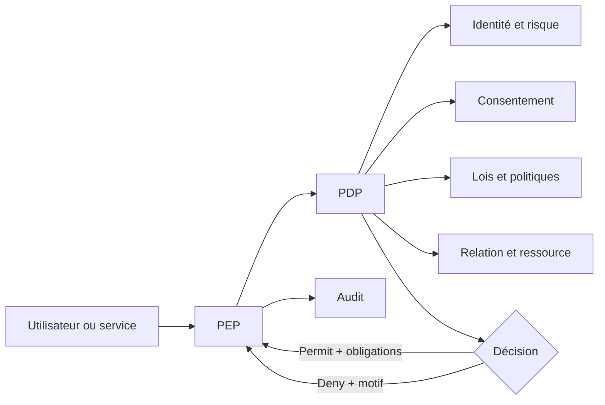

## 6.3 OAuth 2.0, OpenID Connect et SMART on FHIR

- Authorization Code + PKCE obligatoire pour Web/mobile; flux implicite et Resource Owner Password interdits;
- OIDC pour authentification; validation stricte `iss`, `aud`, `exp`, `nbf`, `nonce`, `state`, `azp`;
- rotation des refresh tokens avec détection de réutilisation;
- PAR/JAR recommandés pour clients à haut risque; redirect URIs exactes;
- DPoP pour clients publics capables; mTLS/private_key_jwt pour partenaires et backend;
- JWT d’accès ≤ 5 minutes pour clinique sensible ou jetons opaques introspectés;
- scopes SMART : contexte patient/utilisateur et granularité par ressource; le consentement métier demeure une couche supplémentaire;
- découverte `.well-known/openid-configuration` et `.well-known/smart-configuration`;
- `private_key_jwt` préféré aux secrets partagés pour services FHIR;
- révocation, introspection, rotation de clés et cache contrôlé par `kid`.

## 6.4 MFA et niveaux d’assurance

| Action | Assurance minimale | Step-up |
|---|---|---|
| Consultation patient standard | AAL2 | appareil/risque anormal |
| QR C3/C4, délégation, export | AAL2 renforcé | WebAuthn récent ≤ 5 min |
| Signature prescription | AAL2 + certificat/attestation | à chaque lot ou politique |
| Bris de glace | AAL2 résistant au phishing | toujours |
| Administration IAM/politiques | AAL3 souhaité | toujours, poste géré |
| Support technique avec élévation | JIT + double approbation | session enregistrée |

## 6.5 RBAC, ABAC et consentement

Le RBAC répond à « que peut généralement faire ce rôle? ». L’ABAC répond à « dans ce contexte précis? ». Le consentement répond à « qu’a autorisé la personne concernée? ». La décision effective est l’intersection de ces contrôles et des bases légales.

Attributs : rôle, spécialité, licence, privilège, organisation, relation de soins, épisode, finalité, horaire, localisation, appareil, assurance d’identité, sensibilité, âge, statut du document, consentement, urgence et juridiction.

Obligations possibles : masquer des champs, interdire l’export, appliquer un filigrane, notifier le patient, demander une justification, limiter à un résumé, journaliser au niveau champ, déclencher une revue.

## 6.6 Chiffrement et gestion des clés

- TLS 1.3 externe; TLS 1.2 seulement pour interopérabilité héritée documentée;
- chiffrement au repos AES-256 ou équivalent approuvé;
- chiffrement par enveloppe, DEK par objet ou groupe maîtrisé, KEK dans HSM/KMS;
- clés distinctes par environnement, région et niveau de sensibilité;
- C3/C4 chiffré au niveau applicatif lorsque la menace inclut les administrateurs DB;
- rotation planifiée et rotation d’urgence; destruction cryptographique lorsque permise;
- HMAC pour recherche exacte d’identifiants chiffrés;
- mots de passe Argon2id avec paramètres réévalués; idéalement passkeys;
- secrets dans un coffre avec identité de workload, TTL et rotation;
- signature avec algorithmes approuvés, horodatage et validation de révocation.

## 6.7 Journalisation et audit

Chaque événement sensible enregistre : qui, rôle, organisation, patient, ressource, action, résultat, finalité, base d’autorisation, consentement/grant, date, canal, appareil, corrélation et justification. Les journaux ne stockent pas le contenu clinique complet.

Contrôles : append-only; stockage WORM; chaînage d’empreintes; horodatage fiable; séparation des administrateurs; export signé; réconciliation entre Gateway, service et base; détection de trous; conservation selon juridiction; accès audité aux audits.

Événements obligatoires : authentification, échec, enrôlement MFA, récupération, QR, demande/décision, consultation, recherche, impression, export, signature, correction, fusion patient, bris de glace, changement de rôle/politique, accès support, purge et incident.

## 6.8 Sécurité des API et applications

- autorisation objet et propriété sur chaque endpoint;
- identifiants opaques, pagination bornée, limites de taille et complexité;
- validation allow-list, schémas stricts, protection mass assignment;
- idempotency key pour POST critiques;
- ETag/`If-Match` pour concurrence;
- quotas par utilisateur, client, tenant et flux sensible;
- protection SSRF des imports distants, analyse antivirus/CDR des fichiers;
- egress allow-list et résolution DNS contrôlée;
- CSP, CSRF, XSS, injection, désérialisation et dépendances testées;
- inventaire OpenAPI/SBOM, retrait des versions et tests BOLA automatisés;
- aucune donnée sensible dans URL, métriques, traces ou messages d’erreur.

## 6.9 Confidentialité dès la conception

- registre des finalités et catégories;
- minimisation par écran, API, export, index et notification;
- évaluations des facteurs relatifs à la vie privée avant fonctions à risque;
- séparation soins, paiement, exploitation, recherche et marketing;
- pas de marketing fondé sur PHI sans base juridique explicite;
- pseudonymisation irréversible opérationnellement pour analytique, clé séparée;
- données synthétiques en non-production;
- centre patient : accès, correction, export, restrictions, délégations, journal;
- protection spécifique des mineurs, incapables, génétique, santé mentale et violence;
- décisions automatisées explicables et revue humaine lorsqu’elles ont un impact significatif.

## 6.10 Conservation, sauvegarde et destruction

La durée est déterminée par juridiction, type de détenteur, type de dossier, âge, date du dernier acte, litige, recherche et ordre professionnel. Une matrice juridique validée remplace toute durée codée en dur.

- calcul de l’échéance par moteur de rétention;
- gel légal prioritaire;
- suppression logique seulement pendant la période opérationnelle;
- purge des bases, caches, index et objets;
- expiration des sauvegardes selon cycle documenté;
- certificat de disposition sans contenu clinique;
- anonymisation soumise à une évaluation de réidentification;
- tests réguliers de restauration et de purge.

## 6.11 Sécurité opérationnelle

- SOC 24/7 pour incidents critiques; procédures de notification juridictionnelles;
- EDR sur postes administratifs, MDM sur appareils professionnels;
- PAM, accès JIT, bastion sans presse-papiers pour production;
- double contrôle pour export massif, politiques et clés;
- gestion des vulnérabilités selon criticité et exploitabilité;
- tests d’intrusion, exercices red team et simulation de rançongiciel;
- revue trimestrielle des droits et recertification des comptes privilégiés;
- due diligence fournisseurs, clauses, sous-traitants, localisation et réversibilité;
- plan de continuité clinique et procédure papier/mode panne.

## 6.12 Matrice réglementaire de cadrage

| Référentiel | Applicabilité | Impacts d’architecture |
|---|---|---|
| Québec — Loi sur les renseignements de santé et de services sociaux, R-22.1 | organismes et renseignements visés au Québec | confidentialité, consentement spécifique, droits d’accès/restriction, traçabilité, gouvernance |
| Québec — secteur privé / Loi 25 selon rôle et données | entreprises privées hors exclusions et situations applicables | responsable PRP, EFVP, transparence, incidents, transferts, paramètres de confidentialité |
| RGPD | établissement UE/EEE ou ciblage relevant de son champ | base légale, données art. 9, DPIA, droits, DPO, transferts, privacy by design |
| HDS France | hébergement pour le compte d’acteurs concernés en France | hébergeur certifié HDS, ISO 27001 et exigences HDS/souveraineté applicables |
| HIPAA/HITECH États-Unis | covered entity/business associate et ePHI | safeguards administratifs/physiques/techniques, BAA, minimum necessary, breach notification |
| ISO 27001/27701/27799 | volontaire/contractuel | SMSI, PIMS, contrôles santé, preuves et amélioration continue |

> La conformité n’est pas transitive : héberger chez un fournisseur certifié ne rend pas l’application conforme. Une analyse juridique par marché, un registre des traitements, une EFVP/DPIA, des contrats et des procédures opérationnelles restent nécessaires.

---

# 7. Architecture des API

## 7.1 Principes généraux

- base REST : `/api/v1`; FHIR : `/fhir/R4` ou profil national retenu;
- JSON UTF-8, dates RFC 3339, UUID opaques;
- `Authorization: DPoP/Bearer`, `X-Correlation-Id`, `Idempotency-Key` pour commandes;
- pagination curseur : `?limit=50&cursor=...`, maximum 200;
- filtrage allow-list; aucun champ arbitraire sans contrôle d’autorisation;
- erreurs `application/problem+json` avec `type`, `title`, `status`, `code`, `traceId`; aucun détail sensible;
- `ETag` et `If-Match` sur mises à jour; `202 Accepted` pour traitements longs;
- version dans URL pour API métier; profil/version FHIR dans `CapabilityStatement`;
- webhooks signés, rejouables et idempotents;
- politique de dépréciation publiée, minimum 12 mois sauf urgence sécurité.

### Enveloppes types

```json
{
  "data": { "id": "0199...", "status": "ACTIVE" },
  "meta": { "traceId": "4bf9...", "version": 3 }
}
```

```json
{
  "type": "https://api.example.health/problems/consent-required",
  "title": "Consentement requis",
  "status": 403,
  "code": "CONSENT_REQUIRED",
  "traceId": "4bf9..."
}
```

## 7.2 Catalogue des endpoints — identité, patient et professionnel

Dans les tableaux, « réponse » indique le corps nominal; toutes les réponses peuvent retourner un `ProblemDetails` documenté.

| Méthode et URL | Paramètres | Payload | Réponse |
|---|---|---|---|
| `POST /auth/step-up/challenges` | — | `{action, preferredFactor}` | `201 {challengeId, expiresAt, methods}` |
| `POST /auth/step-up/challenges/{id}/verify` | path `id` | `{assertion}` | `200 {stepUpToken, expiresAt}` |
| `GET /me` | — | — | `200 {user, roles, assurance, organizations}` |
| `GET /me/sessions` | cursor | — | `200 Page<Session>` |
| `DELETE /me/sessions/{id}` | path | — | `204` |
| `GET /patients/{patientId}` | path; `include` allow-list | — | `200 PatientProfile` filtré |
| `PATCH /patients/{patientId}` | `If-Match` | JSON Merge Patch administratif | `200 PatientProfile` |
| `GET /patients/{id}/identifiers` | type, status | — | `200 Page<Identifier>` masqué |
| `POST /patients/{id}/identifiers` | step-up | `{type,system,value,assigner}` | `201 Identifier` masqué |
| `GET /patients/{id}/contacts` | — | — | `200 Contacts` |
| `POST /patients/{id}/contacts` | — | `{relationship,name,channels,priority}` | `201 EmergencyContact` |
| `GET /patients/{id}/representatives` | status | — | `200 Page<Relationship>` |
| `POST /patients/{id}/representatives/invitations` | step-up | `{email,relationship,permissions,expiresAt}` | `202 {invitationId}` |
| `DELETE /patients/{id}/representatives/{relationId}` | reason | — | `204` |
| `GET /patients/{id}/timeline` | from,to,categories,cursor | — | `200 Page<TimelineItem>` |
| `GET /patients/{id}/summary` | `asOf` | — | `200 ClinicalSummary` + fraîcheur |
| `POST /patients/{id}/correction-requests` | — | `{resourceRef,field,reason,proposedValue}` | `201 CorrectionRequest` |
| `POST /patients/{id}/exports` | step-up; idempotency | `{format,scope,dateRange}` | `202 {jobId,statusUrl}` |
| `GET /practitioners` | specialty,org,name,cursor | — | `200 Page<PractitionerPublic>` |
| `GET /practitioners/{id}` | path | — | `200 PractitionerProfile` |
| `GET /practitioners/{id}/licenses` | status,jurisdiction | — | `200 Page<License>` |
| `POST /practitioners/{id}/qualifications` | privilège admin | métadonnées + `documentId` | `201 Qualification` |
| `GET /organizations/{id}` | path | — | `200 Organization` |
| `GET /organizations/{id}/services` | active,type | — | `200 Page<HealthcareService>` |

## 7.3 Catalogue — QR, consentements et accès

| Méthode et URL | Paramètres | Payload | Réponse |
|---|---|---|---|
| `POST /patients/{id}/access-codes` | step-up selon scope | `{purpose,ttlSeconds,presetScope,singleUse}` | `201 {challengeId,qrPayload,expiresAt}` |
| `DELETE /patients/{id}/access-codes/{challengeId}` | path | `{reason}` optionnel | `204` |
| `POST /access-codes/scan` | professionnel authentifié | `{qrPayload,requestedScope,purpose,duration}` | `202 {accessRequestId,expiresAt}` |
| `GET /patients/{id}/access-requests` | status,cursor | — | `200 Page<AccessRequest>` |
| `GET /access-requests/{id}` | path | — | `200 AccessRequestDetails` |
| `POST /access-requests/{id}/decisions` | step-up si C4 | `{decision,scope,duration,conditions}` | `201 {decisionId,grantId?,effectiveScope}` |
| `DELETE /access-requests/{id}` | demandeur | `{reason}` | `204` |
| `GET /patients/{id}/consents` | status,grantee,category | — | `200 Page<ConsentSummary>` |
| `POST /patients/{id}/consents` | step-up; idempotency | `{grantees,purposes,scope,validity,obligations}` | `201 ConsentDirective` |
| `GET /consents/{id}` | path | — | `200 ConsentDirective` + preuve |
| `POST /consents/{id}/versions` | `If-Match`; step-up | nouvelle portée/validité | `201 ConsentVersion` |
| `POST /consents/{id}/revoke` | step-up | `{reason,effectiveAt}` | `202 {revocationId,propagationStatus}` |
| `GET /patients/{id}/access-grants` | active,grantee | — | `200 Page<AccessGrant>` |
| `POST /access-grants/{id}/suspend` | patient/compliance | `{reason}` | `200 AccessGrant` |
| `POST /access-grants/{id}/resume` | step-up | `{reason}` | `200 AccessGrant` |
| `POST /patients/{id}/break-glass` | pro, step-up | `{reasonCode,justification,requestedScope}` | `201 {grantId,expiresAt,reviewId}` |
| `GET /patients/{id}/access-history` | from,to,actor,type,cursor | — | `200 Page<AccessEvent>` |
| `POST /access-events/{id}/report` | patient | `{reason,description}` | `201 {incidentId,status}` |
| `POST /policy/evaluate` | service interne mTLS | `{subject,patient,resource,action,purpose,context}` | `200 {decision,fieldMask,obligations,decisionId}` |

### Exemple — décision d’accès

```json
{
  "decision": "GRANT",
  "scope": [
    {"category": "ALLERGY", "actions": ["READ"]},
    {"category": "MEDICATION", "actions": ["READ"]},
    {"category": "LAB", "actions": ["READ"], "clinicalFrom": "2026-01-01"}
  ],
  "duration": "PT2H",
  "conditions": {"allowDownload": false, "notifyOnUse": true}
}
```

## 7.4 Catalogue — dossier clinique

| Méthode et URL | Paramètres | Payload | Réponse |
|---|---|---|---|
| `GET /patients/{id}/problems` | status,code,cursor | — | `200 Page<Problem>` |
| `POST /patients/{id}/problems` | pro; idempotency | `{code,onset,severity,verification,encounterId}` | `201 Problem` |
| `PATCH /problems/{id}` | `If-Match` | champs autorisés | `200 Problem` nouvelle version |
| `GET /patients/{id}/allergies` | status,criticality | — | `200 Page<Allergy>` |
| `POST /patients/{id}/allergies` | pro/patient déclaré | `{substance,status,criticality,reactions,source}` | `201 Allergy` |
| `GET /patients/{id}/encounters` | from,to,class,cursor | — | `200 Page<Encounter>` |
| `POST /patients/{id}/encounters` | pro/org | `{class,type,start,participants,reason}` | `201 Encounter` |
| `POST /encounters/{id}/close` | `If-Match` | `{endAt,disposition,signature}` | `200 Encounter` |
| `GET /patients/{id}/procedures` | from,to,code | — | `200 Page<Procedure>` |
| `POST /patients/{id}/procedures` | pro | `{code,status,performedAt,performers,outcome}` | `201 Procedure` |
| `GET /patients/{id}/care-plans` | status | — | `200 Page<CarePlan>` |
| `POST /patients/{id}/care-plans` | pro | `{title,period,goals,activities}` | `201 CarePlan` |
| `POST /care-plans/{id}/sign` | step-up; `If-Match` | `{signatureCredentialId}` | `200 SignedCarePlan` |
| `GET /patients/{id}/immunizations` | vaccine,status | — | `200 Page<Immunization>` |
| `POST /patients/{id}/immunizations` | pro/import | `{vaccine,occurrence,lot,dose,performer}` | `201 Immunization` |
| `GET /patients/{id}/recommendations` | type,dueBefore | — | `200 Page<Recommendation>` |
| `GET /patients/{id}/clinical-notes` | type,encounter,cursor | — | `200 Page<NoteSummary>` |
| `POST /patients/{id}/clinical-notes` | pro | `{type,title,content,encounterId,securityLabels}` | `201 ClinicalNote` |
| `POST /clinical-notes/{id}/sign` | step-up; `If-Match` | `{credentialId}` | `200 {status:"SIGNED",signature}` |
| `POST /clinical-notes/{id}/addenda` | pro | `{reason,content}` | `201 Addendum` |

## 7.5 Catalogue — prescriptions

| Méthode et URL | Paramètres | Payload | Réponse |
|---|---|---|---|
| `GET /patients/{id}/prescriptions` | status,from,to | — | `200 Page<Prescription>` |
| `POST /patients/{id}/prescriptions` | prescripteur; idempotency | `{encounterId,items}` | `201 PrescriptionDraft` |
| `GET /prescriptions/{id}` | path | — | `200 Prescription` |
| `PUT /prescriptions/{id}` | `If-Match`; brouillon | objet complet révisé | `200 PrescriptionDraft` |
| `POST /prescriptions/{id}/validate` | — | `{includeDecisionSupport:true}` | `200 {checks,canSign}` |
| `POST /prescriptions/{id}/sign` | step-up; `If-Match` | `{credentialId,overrides[]}` | `200 SignedPrescription` |
| `POST /prescriptions/{id}/transmit` | idempotency | `{pharmacyId,channel}` | `202 {transmissionId,status}` |
| `POST /prescriptions/{id}/cancel` | prescripteur | `{reasonCode,reason}` | `202 Prescription` |
| `POST /prescriptions/{id}/renewal-requests` | patient/pharmacie | `{reason,preferredPharmacyId}` | `201 RenewalRequest` |
| `POST /renewal-requests/{id}/decision` | prescripteur | `{decision,reason,changes}` | `200 {request,newPrescriptionId?}` |
| `POST /prescriptions/{id}/dispenses` | pharmacie | `{itemId,quantity,daysSupply,substitution}` | `201 Dispense` |
| `POST /patients/{id}/medication-reconciliations` | pro | `{encounterId,items,decisions}` | `201 ReconciliationDraft` |
| `POST /medication-reconciliations/{id}/sign` | pro step-up | `{credentialId}` | `200 SignedReconciliation` |

### Exemple — prescription

```json
{
  "encounterId": "0199a100-...",
  "items": [{
    "medication": {"system": "urn:drug-catalog", "code": "AMOX500"},
    "dose": {"value": 500, "unit": "mg"},
    "route": {"system": "http://snomed.info/sct", "code": "26643006"},
    "frequency": {"times": 3, "period": 1, "periodUnit": "d"},
    "duration": {"value": 7, "unit": "d"},
    "quantity": {"value": 21, "unit": "tablet"},
    "substitutionAllowed": true,
    "patientInstruction": "Prendre avec de l'eau."
  }]
}
```

## 7.6 Catalogue — laboratoire, imagerie et documents

| Méthode et URL | Paramètres | Payload | Réponse |
|---|---|---|---|
| `POST /patients/{id}/lab-orders` | prescripteur | `{tests,priority,performerOrgId,reason}` | `201 LabOrder` |
| `GET /patients/{id}/lab-results` | loinc,from,to,status,abnormal | — | `200 Page<Observation>` |
| `GET /diagnostic-reports/{id}` | format json/pdf | — | `200 DiagnosticReport` ou lien court |
| `POST /lab/imports` | partenaire mTLS; idempotency | FHIR Bundle/HL7 document metadata | `202 {importId,statusUrl}` |
| `POST /lab/documents` | multipart préautorisé | `{uploadSessionId,patientHints,reportMetadata}` | `202 {jobId,ocrStatus}` |
| `POST /diagnostic-reports/{id}/finalize` | biologiste step-up | `{signatureCredentialId}` | `200 FinalReport` |
| `POST /diagnostic-reports/{id}/corrections` | biologiste | `{reason,changes,signature}` | `201 CorrectedReport` |
| `POST /critical-results/{id}/acknowledge` | clinicien | `{action,comment}` | `200 CriticalResult` |
| `POST /critical-results/{id}/close` | clinicien | `{outcome,followUp}` | `200 CriticalResult` |
| `POST /patients/{id}/imaging-orders` | prescripteur | `{procedure,modality,reason,priority}` | `201 ImagingOrder` |
| `GET /patients/{id}/imaging-studies` | modality,from,to | — | `200 Page<ImagingStudy>` |
| `GET /imaging-studies/{id}/viewer-token` | step-up si C4 | — | `200 {viewerUrl,token,expiresAt,watermark}` |
| `POST /imaging-studies/{id}/reports` | radiologue | `{findings,impression,documentId}` | `201 ImagingReportDraft` |
| `POST /imaging-reports/{id}/sign` | radiologue step-up | `{credentialId}` | `200 SignedReport` |
| `GET /patients/{id}/documents` | type,from,to,cursor | — | `200 Page<DocumentMetadata>` |
| `POST /documents/upload-sessions` | taille,mime,purpose | `{fileName,size,mimeType,patientId}` | `201 {uploadId,uploadUrl,expiresAt}` |
| `POST /documents/upload-sessions/{id}/complete` | idempotency | `{contentHash}` | `202 {documentId,scanStatus}` |
| `GET /documents/{id}/download` | disposition | — | `302/200` URL signée très courte |
| `POST /documents/{id}/signatures` | step-up | `{credentialId,signatureType}` | `201 Signature` |

## 7.7 Catalogue — rendez-vous, collaboration, IoT et facturation

| Méthode et URL | Paramètres | Payload | Réponse |
|---|---|---|---|
| `GET /availability` | service,practitioner,location,from,to | — | `200 Page<Slot>` |
| `POST /appointments` | idempotency | `{patientId,typeId,slotId,reason,participants}` | `201 Appointment` |
| `PATCH /appointments/{id}` | `If-Match` | changement autorisé | `200 Appointment` |
| `POST /appointments/{id}/cancel` | — | `{reasonCode,comment}` | `200 Appointment` |
| `POST /appointments/{id}/check-in` | patient/pro | `{mode,location}` | `200 {status,queuePosition?}` |
| `GET /telecare/sessions/{id}/join-token` | participant | — | `200 {roomUrl,token,expiresAt}` |
| `GET /conversations` | patientId,status,cursor | — | `200 Page<Conversation>` |
| `POST /conversations` | — | `{patientId,subject,members,initialMessage}` | `201 Conversation` |
| `POST /conversations/{id}/messages` | idempotency | `{body,documentIds,replyTo}` | `201 Message` |
| `POST /messages/{id}/acknowledge` | — | — | `204` |
| `GET /tasks` | assignee,status,dueBefore | — | `200 Page<Task>` |
| `POST /tasks` | — | `{patientId,type,title,assignee,dueAt}` | `201 Task` |
| `PATCH /tasks/{id}` | `If-Match` | `{status,assignee,dueAt}` | `200 Task` |
| `POST /patients/{id}/devices/pairing-challenges` | step-up | `{provider,deviceType}` | `201 {challenge,authorizationUrl}` |
| `DELETE /patients/{id}/devices/{deviceId}` | step-up | `{deleteImportedData:false}` | `202 {revocationStatus}` |
| `GET /patients/{id}/measurements` | metric,from,to,resolution | — | `200 Series<Measurement>` |
| `POST /iot/measurements` | fournisseur mTLS | `{deviceRef,batches[]}` | `202 {accepted,rejected}` |
| `GET /patients/{id}/coverages` | active | — | `200 Page<Coverage>` |
| `POST /patients/{id}/eligibility-checks` | — | `{coverageId,serviceCodes,date}` | `202 EligibilityJob` |
| `GET /patients/{id}/invoices` | status,from,to | — | `200 Page<Invoice>` |
| `POST /invoices/{id}/payments` | idempotency | `{paymentMethodToken,amount}` | `202 Payment` |
| `GET /patients/{id}/claims` | status,from,to | — | `200 Page<Claim>` |
| `POST /claims` | facturation | `{patientId,coverageId,items,diagnoses}` | `201 ClaimDraft` |
| `POST /claims/{id}/submit` | idempotency | — | `202 {transmissionId,status}` |

## 7.8 Catalogue — audit, conformité et administration

| Méthode et URL | Paramètres | Payload | Réponse |
|---|---|---|---|
| `GET /patients/{id}/audit-events` | from,to,actor,category,cursor | — | `200 Page<PatientAuditView>` |
| `GET /compliance/audit-events` | filtres privilégiés | — | `200 Page<AuditEvent>` |
| `POST /privacy-requests` | patient | `{type,scope,details}` | `201 PrivacyRequest` |
| `GET /privacy-requests/{id}` | path | — | `200 PrivacyRequest` |
| `POST /incidents` | patient/pro/système | `{type,severity,description,relatedRefs}` | `201 Incident` |
| `PATCH /incidents/{id}` | privilège conformité; `If-Match` | `{status,owner,actions}` | `200 Incident` |
| `GET /admin/users` | org,role,status,cursor | — | `200 Page<UserAdminView>` |
| `POST /admin/users/{id}/roles` | approbation | `{roleId,organizationId,validity}` | `201 RoleAssignment` |
| `DELETE /admin/users/{id}/roles/{assignmentId}` | reason | — | `204` |
| `POST /admin/policies/{id}/simulate` | politique draft | `{testCases[]}` | `200 {results,coverage}` |
| `POST /admin/policies/{id}/activate` | double approbation | `{changeTicket,effectiveAt}` | `202 Policy` |
| `GET /admin/integrations/{id}/health` | path | — | `200 IntegrationHealth` |
| `POST /admin/messages/{id}/replay` | DLQ, privilège | `{reason,idempotencyOverride:false}` | `202 ReplayJob` |

## 7.9 API FHIR

La façade FHIR doit publier un `CapabilityStatement`, des `StructureDefinition`, `SearchParameter`, `ValueSet`, `CodeSystem`, exemples et tests de conformité. FHIR R4 demeure la base d’interopérabilité la plus largement déployée; R5 peut être utilisé en interne ou pour des partenaires qui le supportent, avec stratégie de conversion explicite.

Endpoints principaux :

- `GET /fhir/R4/metadata`;
- `GET|POST /fhir/R4/Patient`, accès restreint et recherche non énumérable;
- `GET /fhir/R4/Patient/{id}/$everything` asynchrone, strictement autorisé;
- CRUD contrôlé pour `AllergyIntolerance`, `Condition`, `Encounter`, `CarePlan`;
- `MedicationRequest`, `MedicationDispense`, `MedicationAdministration`;
- `ServiceRequest`, `Specimen`, `Observation`, `DiagnosticReport`;
- `ImagingStudy`, `DocumentReference`, `Binary` via accès court;
- `Consent`, `Provenance`, `AuditEvent` avec profils locaux;
- `Appointment`, `Schedule`, `Slot`, `Coverage`, `Claim`;
- opérations Bulk Data `$export` uniquement pour acteurs approuvés, scopes dédiés et sorties chiffrées.

## 7.10 Webhooks et événements

Événements versionnés : `access.requested`, `access.decided`, `access.revoked`, `patient.merged`, `prescription.signed`, `prescription.cancelled`, `lab.report.finalized`, `lab.result.critical`, `imaging.report.signed`, `appointment.changed`, `document.available`, `privacy.request.updated`, `security.incident.detected`.

Chaque enveloppe contient `specversion`, `id`, `type`, `source`, `subject` pseudonymisé, `time`, `datacontenttype`, `dataschema`, `correlationid`; le contenu clinique complet est récupéré ensuite par API autorisée.

---

# 8. Standards de santé et interopérabilité

## 8.1 Stratégie d’interopérabilité

La plateforme utilise un modèle canonique interne aligné sur FHIR et une couche anti-corruption par source. Elle conserve les données originales et la version du standard, puis normalise sans perdre la provenance. Une donnée non mappée n’est jamais inventée; elle est conservée en quarantaine ou sous extension gouvernée.

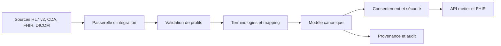

## 8.2 HL7 FHIR

FHIR représente les données sous forme de ressources, profils et opérations REST. La solution doit :

- adopter FHIR R4 pour l’écosystème opérationnel initial et préparer R5 par conversion/versionnage;
- publier un Implementation Guide propre à la plateforme ou adopter les profils nationaux applicables;
- utiliser `CapabilityStatement`, profils, extensions gouvernées, `ValueSet` et `OperationOutcome`;
- préserver `meta.versionId`, `lastUpdated`, profils et labels de sécurité;
- utiliser `Consent` pour exprimer les directives, sans supposer qu’il remplace le PDP;
- produire `Provenance` et `AuditEvent` pour les échanges et actions pertinentes;
- appliquer SMART App Launch pour les applications tierces;
- encadrer Bulk Data Access pour export institutionnel autorisé;
- tester avec validateurs officiels, jeux Touchstone/Inferno pertinents et tests de contrat.

### Profils prioritaires

| Profil/ressource | Usage |
|---|---|
| `Patient`, `RelatedPerson` | identité, représentants et liens |
| `Practitioner`, `PractitionerRole` | identité professionnelle et affiliation |
| `Consent` | directive, portée, période, bénéficiaire, finalité |
| `Condition`, `AllergyIntolerance` | problèmes et allergies |
| `MedicationRequest/Dispense/Administration` | chaîne du médicament |
| `ServiceRequest`, `Observation`, `DiagnosticReport`, `Specimen` | laboratoire et diagnostic |
| `ImagingStudy`, `DocumentReference` | imagerie et documents |
| `CarePlan`, `Goal`, `Task` | coordination |
| `Appointment`, `Schedule`, `Slot` | planification |
| `Provenance`, `AuditEvent` | origine et audit |

## 8.3 HL7 v2 et CDA

HL7 v2 reste incontournable dans les hôpitaux et laboratoires. Flux initiaux :

- ADT A01/A03/A04/A08/A40 pour admissions, mises à jour et fusions;
- ORM/OML pour ordres;
- ORU pour résultats;
- SIU pour rendez-vous;
- MDM pour documents;
- RDE/RDS/RAS pour médicament lorsque disponible.

Le moteur d’interface gère accusés ACK/NACK, profils de message, tables locales, encodage, timeouts, retries, déduplication, quarantaine et replay. Le MLLP est limité aux réseaux privés ou tunnels sécurisés. Chaque transformation possède version, tests et échantillons anonymisés.

CDA est accepté pour sommaires et documents cliniques; le document original signé est conservé et les éléments structurés sont extraits avec provenance.

## 8.4 DICOM et DICOMweb

DICOM est utilisé pour l’échange et la gestion des objets d’imagerie. La plateforme s’intègre à un PACS/VNA et supporte :

- UIDs Study/Series/SOP Instance;
- DICOMweb QIDO-RS pour recherche, WADO-RS pour récupération, STOW-RS pour stockage;
- Structured Reports lorsque disponibles;
- dose reports et métadonnées de modalité;
- DICOM PS3.15/IHE ATNA pour sécurité et audit;
- manifestes et liens sécurisés plutôt que duplication non maîtrisée des pixels;
- anonymisation validée pour usages secondaires, distincte de l’affichage clinique.

## 8.5 ICD-10 et ICD-11

ICD sert principalement à la classification statistique, au codage de morbidité/mortalité et à la facturation selon les adaptations nationales. Les diagnostics cliniques détaillés peuvent être saisis en SNOMED CT puis mappés vers ICD. Les versions et adaptations nationales doivent être stockées; aucun mapping n’est supposé bijectif. Une trajectoire ICD-11 doit être prévue sans retirer ICD-10 tant que les payeurs et autorités l’exigent.

## 8.6 SNOMED CT

SNOMED CT est la terminologie clinique de référence pour problèmes, constatations, procédures, substances, organismes et structures anatomiques. Exigences :

- licence et extension nationale applicables;
- serveur terminologique avec validation, expansion et subsomption;
- conservation du concept ID, de l’édition/version et du terme affiché;
- jeux de référence par contexte et langue;
- expressions post-coordonnées seulement si l’écosystème les gère;
- processus clinique de validation des mappings locaux.

## 8.7 LOINC et UCUM

LOINC identifie analyses, observations, mesures, panels, questionnaires et documents. UCUM code les unités. Une Observation conserve : code LOINC, valeur, unité source, unité UCUM, plage de référence, méthode, spécimen, statut, laboratoire, date et interprétation. Les conversions d’unités sont versionnées, testées et jamais appliquées si la dimension est ambiguë.

## 8.8 IHE et profils complémentaires

| Profil | Usage envisagé |
|---|---|
| PIXm / PDQm | identité et recherche démographique FHIR |
| MHD | partage documentaire mobile/FHIR |
| XDS.b / XCA | fédération documentaire avec écosystèmes existants |
| ATNA | authentification des nœuds et audit |
| XUA / IUA | assertions d’identité et autorisation interentreprises |
| mCSD | répertoires d’organisations, lieux et services |
| PDQ/PIX v2/v3 | intégration héritée |

## 8.9 Gouvernance terminologique

- comité terminologique clinique et technique;
- catalogue des versions autorisées et dates d’effet;
- mappings à quatre yeux pour usages cliniques/financiers;
- statut exact, équivalent, plus large, plus étroit, non mappable;
- tests de régression lors d’une nouvelle édition;
- conservation du code source même après mapping;
- surveillance des codes inactifs et mécanisme de remplacement;
- aucune mise à jour automatique d’un code historique signé.

## 8.10 Contrats et certification d’interopérabilité

- OpenAPI et packages FHIR publiés dans un registre;
- schémas d’événements versionnés et politique de compatibilité;
- environnements sandbox avec données synthétiques;
- tests consommateurs/producteurs;
- tests de conformité DICOM, FHIR et IHE selon partenaires;
- matrice de prise en charge par partenaire;
- SLA, accusés, rapprochement quotidien et alertes de dérive;
- procédure de changement coordonné et fenêtre de coexistence.

---

# 9. Roadmap produit

## 9.1 Principes de priorisation

Prioriser selon : sécurité patient, conformité, valeur clinique, dépendances, réduction du risque, interopérabilité et adoption. Aucune fonctionnalité IA ou analytique secondaire ne précède l’identité, la qualité, le consentement, la provenance et l’audit.

## 9.2 Phase 0 — cadrage et fondations (0 à 4 mois)

### Livrables

- choix des juridictions et qualification juridique des rôles;
- gouvernance clinique, données, sécurité et terminologies;
- EFVP/DPIA initiale, modèle de menace, politique de conservation;
- architecture de référence, ADR, stratégie cloud/résidence;
- MPI prototype, IAM, MFA, CI/CD, observabilité et données synthétiques;
- Implementation Guide FHIR minimal;
- prototypes UX testés avec patients, cliniciens et personnes vulnérables.

### Gate de sortie

Responsabilités juridiques approuvées, risques critiques traités, identité professionnelle vérifiable, parcours de consentement compris par les utilisateurs, et architecture testée en charge sur un flux clinique synthétique.

## 9.3 MVP — confiance et dossier essentiel (mois 5 à 12)

### Must have

- comptes patients/professionnels, preuve d’identité, MFA, organisations;
- MPI, profil patient, contacts d’urgence et représentants simples;
- QR dynamique, demande en temps réel, acceptation/refus, accès temporaire;
- consentement par catégories, révocation et journal patient;
- synthèse : allergies, problèmes, médicaments, vaccinations, documents;
- imports FHIR/HL7 de base et PDF sécurisé;
- rendez-vous et notifications;
- audit immuable, SIEM, sauvegarde et reprise;
- Web responsive et applications mobiles avec fonctions critiques;
- API partenaire limitée et sandbox.

### Should have

- accès permanent au médecin traitant;
- correction/commentaire patient;
- résultats de laboratoire structurés non complexes;
- messagerie sécurisée simple.

### Exit criteria

- aucun risque critique ouvert;
- test d’intrusion et exercice de reprise réussis;
- taux de rapprochement erroné sous seuil clinique approuvé;
- révocation propagée < 60 s au p99;
- accessibilité AA sur parcours critiques;
- pilote avec organisations limitées et comité de sécurité patient.

## 9.4 Version 1 — parcours cliniques intégrés (mois 13 à 20)

- prescriptions, signature, transmission, renouvellement et dispensation;
- laboratoire complet, OCR supervisé et résultats critiques;
- imagerie, DICOMweb et compte rendu;
- plans de soins, objectifs, tâches et références;
- télésanté et salle d’attente;
- délégation avancée, mineurs et mandats;
- facturation, couverture et réclamations de base;
- consentements fins par période, ressource et finalité;
- bris de glace avec revue;
- applications SMART on FHIR sélectionnées;
- portail conformité et demandes de droits.

## 9.5 Version 2 — prévention, IoT et échelle multi-régionale (mois 21 à 30)

- appareils connectés, agrégation et qualité des mesures;
- prévention personnalisée validée et rappels avancés;
- réadaptation, nutrition, activité et PROM/PREM;
- génétique interprétée avec consentement renforcé;
- fédération documentaire IHE et nouveaux partenaires;
- analytique opérationnelle pseudonymisée;
- multi-région, optimisation de recherche et extraction de services à forte charge;
- règles d’autorisation multi-juridictions plus avancées;
- export patient complet FHIR et portabilité interplateforme.

## 9.6 Version 3 — écosystème national et intelligence clinique gouvernée (31 mois et plus)

- place de marché d’applications SMART certifiées;
- coordination interrégionale et réseau de confiance;
- recherche secondaire avec gouvernance et espaces sécurisés;
- aide à la décision clinique explicable, validée comme dispositif si applicable;
- apprentissage fédéré ou environnements sécurisés sans exfiltration brute;
- parcours populationnels, santé publique et mesures de résultats;
- identité et consentement transfrontaliers selon accords;
- automatisation de conformité et contrôles continus.

## 9.7 Vue synthétique

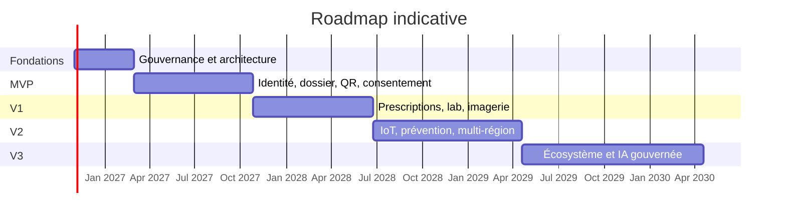

## 9.8 Équipe cible

| Fonction | MVP indicatif |
|---|---:|
| Product management / analyse métier | 3–5 |
| Architecture entreprise/solution/données | 3–4 |
| Développement backend/intégration | 10–16 |
| Web/mobile | 8–12 |
| QA automatisation/performance | 5–8 |
| DevSecOps/SRE | 4–6 |
| Sécurité, vie privée et conformité | 4–6 |
| Informatique clinique/terminologie | 4–6 |
| UX research/design/accessibilité | 3–5 |
| Support, exploitation et onboarding partenaires | 4–8 |

Ces ordres de grandeur dépendent fortement du nombre de juridictions, de partenaires et de flux existants.

## 9.9 Principaux risques programme

| Risque | Probabilité/impact | Réponse |
|---|---|---|
| Qualification juridique erronée du rôle de plateforme | M/Très élevé | avis local, contrats, RACI, gate avant pilote |
| Mauvais rapprochement patient | M/Très élevé | MPI multi-attribut, revue humaine, fusion réversible |
| Consentement trop complexe | Élevée/Élevé | UX research, presets sûrs, langage clair, tests de compréhension |
| Données de faible qualité | Élevée/Élevé | provenance, score, validation, rapprochement et SLA partenaire |
| Explosion microservices | M/Élevé | monolithe modulaire, critères d’extraction |
| Dépendance fournisseur/cloud | M/Moyen | standards, IaC, export, clauses de réversibilité |
| Fatigue d’alertes | Élevée/Élevé | gouvernance clinique, seuils, mesure de valeur positive |
| Cyberattaque/rançongiciel | Élevée/Très élevé | Zero Trust, segmentation, EDR, backups immuables, exercices |
| Adoption professionnelle faible | M/Élevé | intégration au workflow, SMART, pilotes, mesure de charge |
| Coût imagerie/IoT | M/Élevé | tiering, rétention, compression licite, budgets/quotas |

---

# 10. Annexes

## 10.1 Diagramme de cas d’utilisation

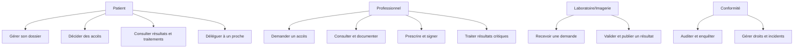

## 10.2 Diagramme d’activité — demande d’accès

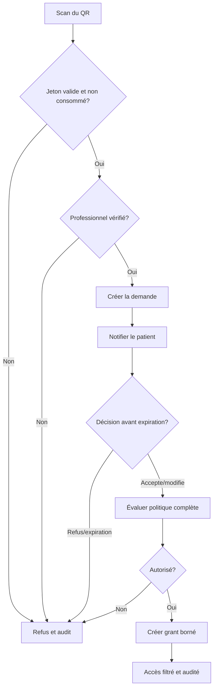

## 10.3 Diagramme d’état — consentement

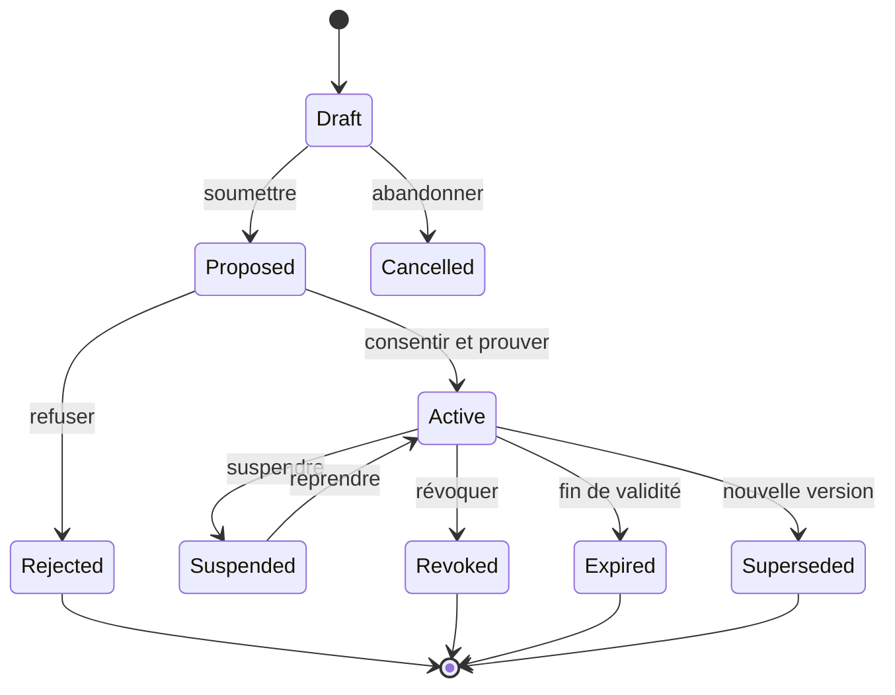

## 10.4 Diagramme de classes conceptuel

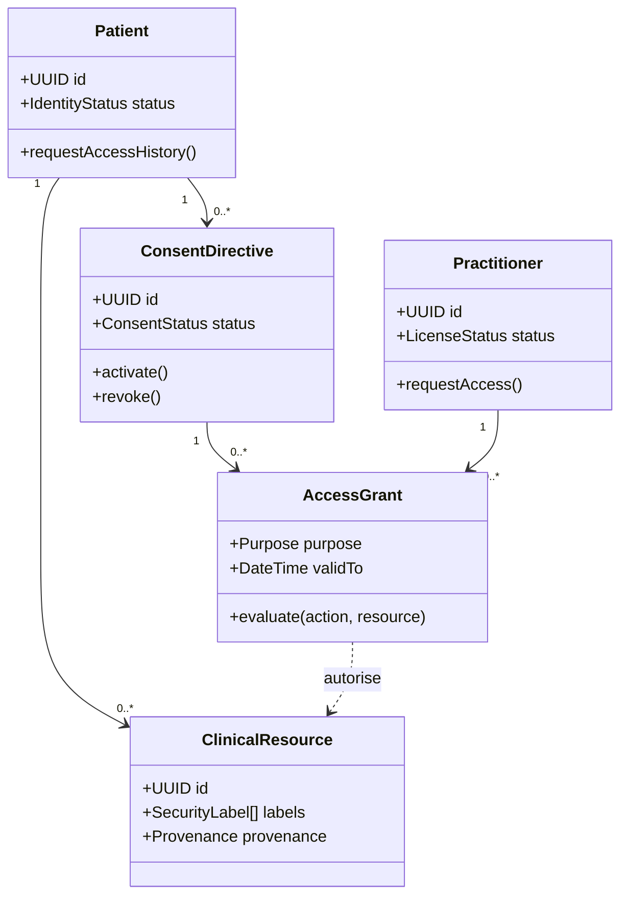

## 10.5 Déploiement

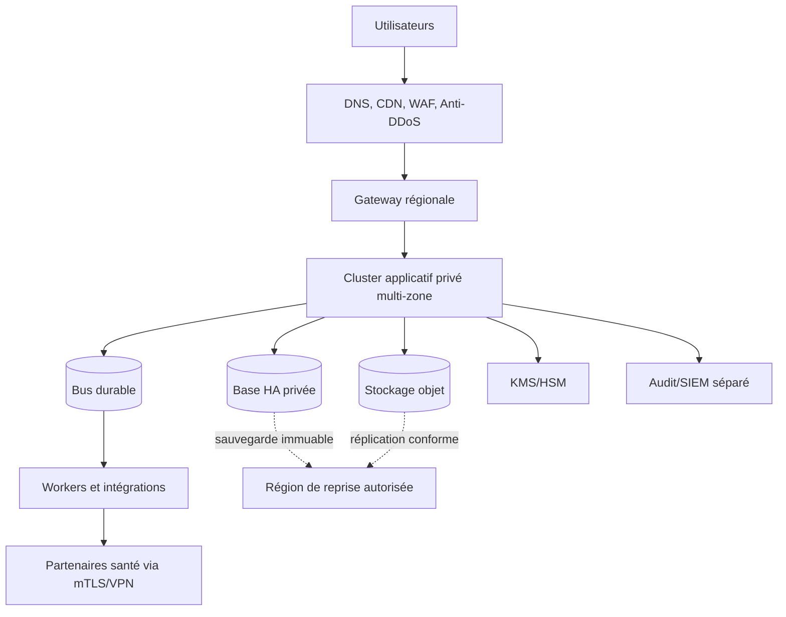

## 10.6 Séquence — résultat critique

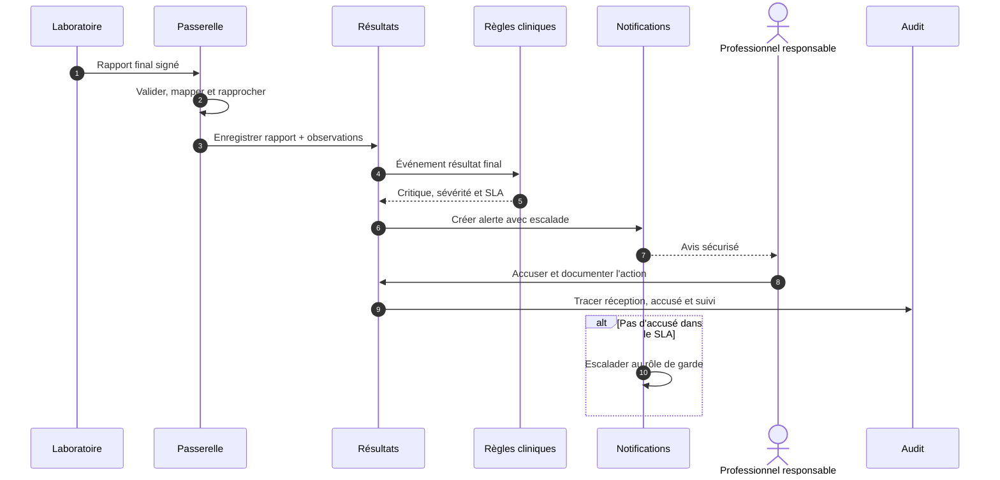

## 10.7 Exigences non fonctionnelles détaillées

| ID | Exigence | Mesure d’acceptation |
|---|---|---|
| NFR-AV-01 | Lecture clinique disponible | ≥ 99,95 % mensuel hors maintenance annoncée |
| NFR-PE-01 | Décision PDP | p95 < 100 ms, p99 < 250 ms à charge nominale |
| NFR-PE-02 | Synthèse patient | p95 < 800 ms hors contenu binaire |
| NFR-SC-01 | Échelle | 10 M patients, 100 k professionnels, 20 k req/s pic cible à valider |
| NFR-DR-01 | Reprise | RPO ≤ 5 min, RTO ≤ 60 min pour cœur clinique |
| NFR-SE-01 | Révocation | application aux nouveaux accès p99 < 60 s |
| NFR-SE-02 | Audit | 100 % des accès C2–C4 corrélés à une décision |
| NFR-SE-03 | Chiffrement | TLS et chiffrement au repos vérifiés automatiquement |
| NFR-AC-01 | Accessibilité | WCAG 2.2 AA, tests automatiques + humains |
| NFR-IN-01 | Interopérabilité | profils FHIR validés; taux de rejet explicable à 100 % |
| NFR-QL-01 | Provenance | 100 % des ressources cliniques avec source/auteur/date/statut |
| NFR-OP-01 | Observabilité | trace distribuée de 99 % des requêtes critiques |
| NFR-CO-01 | Résidence | aucune réplication hors régions autorisées |
| NFR-MA-01 | Maintenabilité | tests d’architecture bloquent les dépendances interdites |
| NFR-US-01 | Compréhension consentement | ≥ 90 % de réussite aux tests utilisateurs critiques |

## 10.8 Matrice de traçabilité simplifiée

| Besoin | Capacités | Données | API | Contrôles |
|---|---|---|---|---|
| Accès QR | challenge, demande, décision | `qr_challenge`, `access_request`, `access_grant` | `/access-codes/*`, `/access-requests/*` | usage unique, MFA, PDP, audit |
| Révocation | consentement et propagation | `consent_directive`, `revocation_event` | `/consents/{id}/revoke` | introspection, invalidation cache |
| Prescription | médicament/signature | `prescription*`, `signature` | `/prescriptions/*` | licence, CDS, immutabilité |
| Résultat lab | ingestion/validation | `diagnostic_report`, `observation` | `/lab/imports`, `/diagnostic-reports/*` | signature, provenance, criticité |
| Journal patient | transparence | `audit_event`, `policy_decision_log` | `/patients/{id}/audit-events` | vue expurgée, append-only |
| Délégation | représentant/portée | `patient_relationship`, `consent_*` | `/representatives/*` | identité, durée, non-redélégation |

## 10.9 RACI de gouvernance

| Décision | Produit | Clinique | Architecture | Sécurité | Vie privée/juridique | Exploitation |
|---|---|---|---|---|---|---|
| Portée fonctionnelle | A/R | C | C | C | C | I |
| Règle clinique/alerte | C | A/R | C | I | C | I |
| Politique d’accès | C | C | R | R | A | I |
| Terminologie/mapping | I | A/R | C | I | I | I |
| Architecture cible | C | C | A/R | C | C | C |
| Incident de confidentialité | I | C | C | R | A/R | R |
| Mise en production | A | C | R | R | C | R |

`R` responsable de l’exécution; `A` imputable; `C` consulté; `I` informé.

## 10.10 Catalogue initial des événements

| Événement | Producteur | Consommateurs | Données minimales |
|---|---|---|---|
| `patient.registered.v1` | Patient | MPI, notifications, audit | patient ref, tenant, time |
| `patient.merged.v1` | MPI | tous domaines patients | survivant, fusionné, version |
| `access.requested.v1` | Consentement | notification, audit | request ref, patient ref, expiry |
| `access.decided.v1` | Consentement | Gateway, notification, audit | decision, grant ref, scope hash |
| `access.revoked.v1` | Consentement | tous PEP/caches | grant/consent ref, effectiveAt |
| `prescription.signed.v1` | Médicament | pharmacie, patient, audit | prescription ref, hash |
| `lab.report.finalized.v1` | Laboratoire | dossier, règles, notification | report ref, patient ref |
| `lab.result.critical.v1` | Règles | alerte/escalade | critical ref, severity, SLA |
| `appointment.changed.v1` | Planification | notification, télésoin | appointment ref, status/time |
| `document.available.v1` | Documents | dossier, notification | document ref, type |

## 10.11 Décisions d’architecture à formaliser (ADR)

1. juridictions de lancement et rôles juridiques exacts;
2. cloud, régions, HDS/HIPAA et modèle de clés;
3. FHIR R4/profils nationaux et calendrier R5;
4. technologie IAM et intégration aux identités gouvernementales;
5. PostgreSQL ou SQL Server;
6. PACS/VNA existant ou service géré;
7. stratégie de signature qualifiée/avancée par marché;
8. moteur PDP : OPA/Cedar/produit commercial/développement contrôlé;
9. politique d’accès du mineur et du représentant par juridiction;
10. modèle de responsabilité des recommandations et de l’IA;
11. durées de conservation par catégorie;
12. seuils d’extraction des microservices.

## 10.12 Questions ouvertes pour ateliers

- La plateforme est-elle dossier de référence, agrégateur, intermédiaire ou sous-traitant pour chaque flux?
- Quels organismes sont dépositaires des originaux?
- Quelles données le patient peut-il masquer sans compromettre une obligation clinique ou légale?
- Quels accès d’urgence sont permis et par quels rôles?
- Les mineurs disposent-ils d’un compte autonome à partir de quel âge et pour quels soins?
- Quels registres d’identité/professionnels sont disponibles par territoire?
- Quels profils FHIR nationaux et systèmes de codes sont obligatoires?
- La prescription électronique doit-elle intégrer un réseau national/provincial?
- Quels résultats nécessitent délai de publication ou accompagnement?
- Quelles données restent hors plateforme mais référencées?
- Quelle volumétrie DICOM, IoT et documents sur cinq ans?
- Quels SLA les partenaires acceptent-ils?

## 10.13 Critères globaux de mise en service

- avis juridique et EFVP/DPIA approuvés;
- registre des traitements, contrats et sous-traitants complétés;
- threat model sans risque critique non traité;
- tests d’intrusion, sécurité mobile/API et remédiation;
- performance, charge, endurance et chaos tests réussis;
- restauration complète démontrée dans les RTO/RPO;
- parcours urgence et mode panne testés avec cliniciens;
- exactitude MPI mesurée et seuils approuvés;
- règles d’alertes validées et absence de fatigue critique;
- conformité FHIR/HL7/DICOM vérifiée sur flux pilotes;
- accessibilité et tests d’utilisabilité réussis;
- support, astreinte, runbooks, formation et communications prêts;
- journal d’audit reconstituable de bout en bout;
- révocation, export, correction, incident et purge testés.

## 10.14 Glossaire

| Terme | Définition |
|---|---|
| ABAC | Contrôle d’accès fondé sur des attributs et le contexte |
| DICOM | Standard d’imagerie et d’échange médical |
| DME/DPI | Dossier médical/du patient informatisé |
| FHIR | Standard HL7 d’échange de ressources de santé |
| HDS | Certification française d’hébergement de données de santé |
| IAM | Gestion des identités et des accès |
| MPI | Index maître des patients |
| OIDC | OpenID Connect, couche d’identité sur OAuth 2.0 |
| PDP/PEP | Point de décision / point d’application des politiques |
| PHI/ePHI | Renseignement de santé protégé, notamment électronique |
| RBAC | Contrôle d’accès fondé sur les rôles |
| RPO/RTO | Perte de données maximale / temps de reprise maximal |
| SMART | Profil OAuth pour applications FHIR |
| SNOMED CT | Terminologie clinique de référence |
| UCUM | Système de codification unifiée des unités |
| WORM | Stockage inscriptible une fois, non modifiable ensuite |

## 10.15 Références officielles

Références consultées le 5 octobre 2026. Elles cadrent l’architecture mais ne remplacent pas un avis juridique ni les profils nationaux applicables.

1. Gouvernement du Québec, [Loi sur les renseignements de santé et de services sociaux, R-22.1](https://www.legisquebec.gouv.qc.ca/fr/document/lc/R-22.1).
2. Gouvernement du Québec, [Règlement d’application de certaines dispositions de la Loi sur les renseignements de santé et de services sociaux](https://www.legisquebec.gouv.qc.ca/fr/document/rc/R-22.1%2C%20r.%201).
3. Gouvernement du Québec, [Loi sur la protection des renseignements personnels dans le secteur privé, P-39.1](https://www.legisquebec.gouv.qc.ca/fr/document/lc/p-39.1).
4. Union européenne, [Règlement (UE) 2016/679 — RGPD](https://eur-lex.europa.eu/eli/reg/2016/679/oj).
5. U.S. HHS, [Summary of the HIPAA Security Rule](https://www.hhs.gov/hipaa/for-professionals/security/laws-regulations/index.html).
6. Agence du Numérique en Santé, [Référentiels de certification HDS](https://esante.gouv.fr/services/hebergeurs-de-donnees-de-sante/les-referentiels-de-la-procedure-de-certification).
7. HL7 International, [FHIR R5 — Consent](https://hl7.org/fhir/R5/consent.html), [AuditEvent](https://hl7.org/fhir/R5/auditevent.html) et [Security Labels](https://hl7.org/fhir/security-labels.html).
8. HL7 International, [SMART App Launch 2.2](https://hl7.org/fhir/smart-app-launch/).
9. DICOM Standards Committee/NEMA, [DICOM PS3.1 — Introduction and Overview](https://dicom.nema.org/medical/dicom/current/output/chtml/part01/ps3.1.html).
10. Organisation mondiale de la Santé, [International Classification of Diseases](https://www.who.int/standards/classifications/classification-of-diseases).
11. SNOMED International, [SNOMED CT Overview](https://docs.snomed.org/snomed-ct-practical-guides/snomed-ct-data-analytics-guide/4-snomed-ct-overview).
12. Regenstrief Institute, [About LOINC](https://loinc.org/about).
13. NIST, [SP 800-207 — Zero Trust Architecture](https://www.nist.gov/publications/zero-trust-architecture).
14. IETF, [RFC 9700 — Best Current Practice for OAuth 2.0 Security](https://www.rfc-editor.org/rfc/rfc9700.html).
15. OWASP, [API Security Top 10 — 2023](https://api-security.owasp.org/editions/2023/en/0x11-t10/).

---

## Conclusion

La plateforme doit être construite comme une infrastructure de confiance clinique, et non comme un simple portail documentaire. Son succès dépend moins du nombre de fonctions que de la qualité des identités, de la provenance, du consentement calculable, de l’interopérabilité, de l’audit et de la gouvernance clinique.

Le choix recommandé — cœur modulaire, événements versionnés, composants spécialisés isolés et extraction progressive — réduit le risque initial tout en préparant l’échelle nationale. Le patient dispose d’une maîtrise réelle et vérifiable, mais cette maîtrise s’exerce dans un cadre où les obligations légales, la sécurité des soins, les responsabilités des professionnels et la conservation probante restent explicites. Toute décision d’accès doit donc être minimale, contextuelle, explicable, révocable et auditée.
